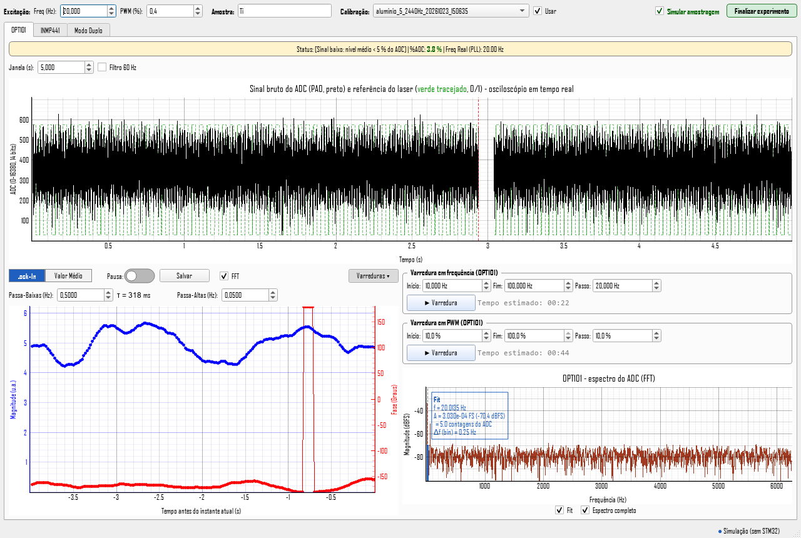

# SOI Controller: lock-in fotoacústico com STM32, OPT101 e INMP441

Sistema de baixo custo para medidas fotoacústicas com detecção lock-in. Um **STM32F401 (Black Pill)** modula um laser em onda quadrada e mede, ao mesmo tempo:

- a **intensidade óptica** com o fotodiodo **OPT101** (ADC, 12,5 kS/s, 14 bits efetivos);
- o **sinal acústico** com o microfone MEMS **INMP441** (I2S, ≈32 kS/s, 24 bits).

Os dois fluxos vão por USB (CDC) para o PC. A interface em Python faz a demodulação lock-in dos dois canais, mostra os gráficos, executa varreduras em frequência e em potência, calibra o microfone e grava as medidas em CSV/PNG.



```
             PWM + modulação (PA8)            ┌──────────────┐
  ┌────────┐ ───────────────────────────────► │ Driver/Laser │ ──► luz ──┐
  │        │                                  └──────────────┘           │
  │ STM32  │ ◄── PA0 (ADC) ──── OPT101 ◄──────────── luz (referência) ───┤
  │ F401   │                                                             ▼
  │ Black  │ ◄── PB12/13/15 (I2S) ── INMP441 ◄── som ── célula fotoacústica
  │ Pill   │
  │        │ ──► PB0: sincronismo (osciloscópio)
  └───┬────┘
      │ USB-C (CDC, VID 0483 / PID 5740)
      ▼
  PC: SOI Controller (Python + PyQt/pyqtgraph)
```

## Hardware

| Componente | Função | Ligação |
|---|---|---|
| WeAct Black Pill STM32F401CCU6 (cristal de 25 MHz) | Controle, sincronismo e aquisição | USB-C ao PC; SWD ao ST-Link para gravar |
| OPT101 (fotodiodo + amplificador de transimpedância) | Referência de intensidade do laser | Saída → **PA0** (máx. 3,3 V) |
| INMP441 (microfone MEMS I2S) | Sinal fotoacústico | SCK → **PB13**, WS → **PB12**, SD → **PB15**, L/R → GND, VDD → 3V3 |
| Laser + driver | Excitação modulada | Entrada TTL do driver ← **PA8** (PWM de 5 kHz, 0–100 %) |
| Osciloscópio (opcional) | Ver a modulação | **PB0** (1 = laser ligado) |

O PA8 só fornece sinal lógico de 3,3 V: use sempre um driver (transistor/MOSFET ou a entrada TTL do driver do laser). Detalhes, cuidados e diagrama em [docs/02_Hardware_e_Ligacoes.md](docs/02_Hardware_e_Ligacoes.md).

## Início rápido

1. Monte o hardware conforme [docs/02_Hardware_e_Ligacoes.md](docs/02_Hardware_e_Ligacoes.md).
2. Grave o firmware da pasta [`firmware/`](firmware/) com o PlatformIO e um ST-Link:
   ```bash
   cd firmware
   pio run -t upload
   ```
3. Instale as dependências da interface (Python 3.10 ou superior):
   ```bash
   pip install -r requirements.txt
   ```
4. Conecte a Black Pill pelo USB-C e rode:
   ```bash
   python interface/stm32_opt_inmmp_novo.py
   ```
   A porta é detectada sozinha. Sem o STM32 conectado, marque **Simular amostragem** para testar a interface com sinais simulados.
5. As medidas são gravadas na pasta `Medidas/`, criada ao lado do script (ou do executável).

## Documentação

| Documento | Conteúdo |
|---|---|
| [01_Materiais.md](docs/01_Materiais.md) | Hardware e software necessários |
| [02_Hardware_e_Ligacoes.md](docs/02_Hardware_e_Ligacoes.md) | Pinagem da Black Pill e ligações de OPT101, INMP441, laser e ST-Link |
| [03_Firmware_STM32.md](docs/03_Firmware_STM32.md) | Relógios, timers, ADC, I2S, DMA, USB, protocolo serial e gravação |
| [04_Interface.md](docs/04_Interface.md) | Instalação, funcionalidades e especificações da interface |
| [05_Componentes.md](docs/05_Componentes.md) | Por que STM32, OPT101 e INMP441: características e papel de cada um |
| [06_Desempenho_e_Aplicacoes.md](docs/06_Desempenho_e_Aplicacoes.md) | Velocidade e resolução das medidas ópticas no tempo; lente térmica, espelho térmico e luminescência |

## Estrutura do repositório

```
├── interface/
│   └── stm32_opt_inmmp_novo.py   Interface + lock-in (PySide6/PyQt + pyqtgraph + NumPy/SciPy)
├── firmware/                     Firmware do STM32 (PlatformIO, framework Arduino-STM32)
│   ├── platformio.ini
│   └── src/main.cpp
├── docs/                         Documentação
├── CHANGELOG.md                  Histórico de versões
├── requirements.txt              Dependências Python
└── LICENSE
```

## Versões

Cada versão publicada tem uma tag `vX.Y.Z` e uma página em [Releases](https://github.com/mbelancon/SOI/releases). O que mudou em cada uma está no [CHANGELOG.md](CHANGELOG.md). O número aparece no título da janela da interface e na constante `FIRMWARE_VERSION` do firmware.

## Licença

Distribuído sob a licença GPL-3.0 (GNU General Public License v3.0). Veja [LICENSE](LICENSE).
