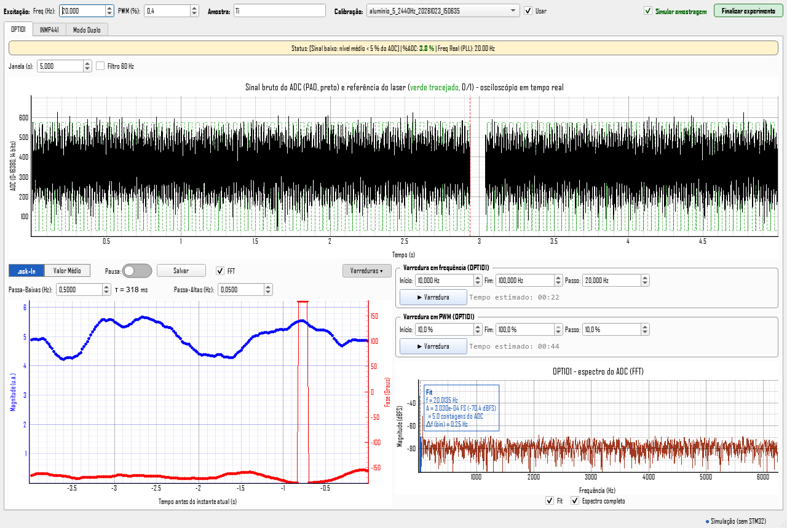

# SOI Controller: photoacoustic lock-in with STM32, OPT101 and INMP441

A low-cost system for photoacoustic measurements with lock-in detection. An **STM32F401 (Black Pill)** modulates a laser with a square wave and simultaneously measures:

- the **optical intensity** with the **OPT101** photodiode (12-bit ADC at 200 kS/s, oversampling adjustable in the interface);
- the **acoustic signal** with the **INMP441** MEMS microphone (I2S, 48 kS/s, 24 bits).

Both streams go to the PC over USB (CDC). The Python interface performs lock-in demodulation on both channels, plots the results, runs frequency and power sweeps, calibrates the microphone and saves measurements as CSV/PNG.

> The interface itself is currently in Portuguese; the labels quoted in these documents (e.g. **Modo Duplo**, **Calibração**) are the ones shown on screen.



```
             PWM + modulation (PA8)           ┌──────────────┐
  ┌────────┐ ───────────────────────────────► │ Driver/Laser │ ──► light ──┐
  │        │                                  └──────────────┘             │
  │ STM32  │ ◄── PA0 (ADC) ──── OPT101 ◄────────── light (reference) ──────┤
  │ F401   │                                                               ▼
  │ Black  │ ◄── PB12/13/15 (I2S) ── INMP441 ◄── sound ── photoacoustic cell
  │ Pill   │
  │        │ ──► PB0: sync (oscilloscope)
  └───┬────┘
      │ USB-C (CDC, VID 0483 / PID 5740)
      ▼
  PC: SOI Controller (Python + PyQt/pyqtgraph)
```

## Hardware

| Component | Role | Connection |
|---|---|---|
| WeAct Black Pill STM32F401CCU6 (25 MHz crystal) | Control, synchronization and acquisition | USB-C to the PC; SWD to the ST-Link for flashing |
| OPT101 (photodiode + transimpedance amplifier) | Laser intensity reference | Output → **PA0** (max. 3.3 V) |
| INMP441 (I2S MEMS microphone) | Photoacoustic signal | SCK → **PB13**, WS → **PB12**, SD → **PB15**, L/R → GND, VDD → 3V3 |
| Laser + driver | Modulated excitation | Driver TTL input ← **PA8** (5 kHz PWM, 0–100 %) |
| Oscilloscope (optional) | Watch the modulation | **PB0** (1 = laser on) |

PA8 only provides a 3.3 V logic signal: always use a driver (transistor/MOSFET or the TTL input of the laser driver). Details, precautions and a diagram are in [docs/02_Hardware_and_Wiring.md](docs/02_Hardware_and_Wiring.md).

## Quick start

**Just want to use the interface on Windows?** Download `SOI_Controller_vX.Y.Z.exe` from the latest [Release](https://github.com/mbelancon/SOI/releases/latest) and run it. No Python installation is needed. Requires Windows 10/11 and a CPU with SSE4.2 (Intel since 2009 or AMD since 2011). Older CPUs, such as AMD Phenom II and Intel Core 2, cannot run the program. Details in [docs/04_Interface.md](docs/04_Interface.md#installation-and-running).

1. Assemble the hardware following [docs/02_Hardware_and_Wiring.md](docs/02_Hardware_and_Wiring.md).
2. Flash the firmware in [`firmware/`](firmware/) with PlatformIO and an ST-Link. The firmware is written with **STM32Cube** (ST HAL + ST USB Device library); it does not use STM32duino/Arduino:
   ```bash
   cd firmware
   pio run -t upload
   ```
   Or flash the prebuilt binary `binarios/soi_firmware_vX.Y.Z.bin` at address `0x08000000` with STM32CubeProgrammer. Firmware and interface must share the same MAJOR version (2.x does not talk to 1.0.0). Details in [docs/03_STM32_Firmware.md](docs/03_STM32_Firmware.md).
3. Install the interface dependencies (Python 3.10 or newer):
   ```bash
   pip install -r requirements.txt
   ```
4. Connect the Black Pill over USB-C and run:
   ```bash
   python interface/soi_controller.py
   ```
   The port is detected automatically. Without the STM32 connected, tick **Simular amostragem** (simulate sampling) to try the interface with simulated signals.
5. Measurements are saved in the `Medidas/` folder, created next to the script (or the executable).

## Documentation

| Document | Contents |
|---|---|
| [01_Materials.md](docs/01_Materials.md) | Required hardware and software |
| [02_Hardware_and_Wiring.md](docs/02_Hardware_and_Wiring.md) | Black Pill pinout and wiring of the OPT101, INMP441, laser and ST-Link |
| [03_STM32_Firmware.md](docs/03_STM32_Firmware.md) | Clocks, timers, ADC, I2S, DMA, USB, serial protocol and flashing |
| [04_Interface.md](docs/04_Interface.md) | Installation, features and specifications of the interface |
| [05_Components.md](docs/05_Components.md) | Why STM32, OPT101 and INMP441: characteristics and role of each |
| [06_Performance_and_Applications.md](docs/06_Performance_and_Applications.md) | Speed and resolution of time-resolved optical measurements; thermal lens, thermal mirror and luminescence |

## Repository layout

```
├── interface/
│   └── soi_controller.py         Interface + lock-in (PySide6/PyQt + pyqtgraph + NumPy/SciPy)
├── firmware/                     STM32 firmware (PlatformIO, STM32Cube framework, ST USB stack)
│   ├── platformio.ini
│   ├── include/                  HAL and USB configuration
│   └── src/main.c                (src/usb = ST USB Device library)
├── binarios/                     Prebuilt firmware (.bin) for flashing without compiling
├── docs/                         Documentation (docs/tests: test procedures for each version)
├── packaging/                    PyInstaller spec and dependencies (Windows executable)
├── .github/workflows/            Automatic build of the executable for Releases
├── CHANGELOG.md                  Version history
├── requirements.txt              Python dependencies
└── LICENSE
```

## Versions

Each published version has a `vX.Y.Z` tag and a page under [Releases](https://github.com/mbelancon/SOI/releases). What changed in each one is in [CHANGELOG.md](CHANGELOG.md). The number appears in the interface window title and in the firmware constant `FIRMWARE_VERSION`.

## License

Distributed under the GPL-3.0 license (GNU General Public License v3.0). See [LICENSE](LICENSE).

---


Developed at LCTM (Laboratório de Ciência e Tecnologia de Materiais — Materials Science and Technology Laboratory). The icon of the interface and the executable comes from the laboratory logo (`docs/images/logo_lctm.svg`).
