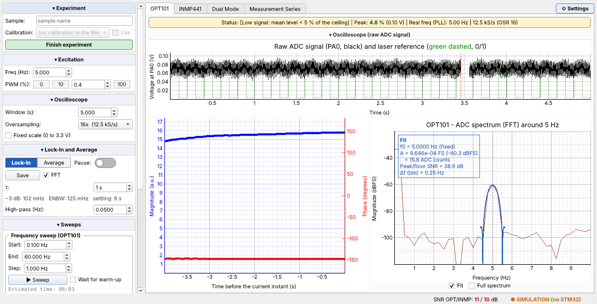

# 4. PC interface – SOI Controller

File to run: [`interface/soi_controller.py`](../interface/soi_controller.py) (the window's parts are in `interface/soi_win_*.py`). Built with PyQt/PySide + pyqtgraph. The lock-in is computed in Python (numpy/scipy), in [`interface/soi_dsp.py`](../interface/soi_dsp.py).

**Language.** The interface is bilingual (Portuguese and English) and picks the language from the Windows display language: Portuguese if Windows is in Portuguese, English otherwise. The environment variable `SOI_LANG=pt` or `SOI_LANG=en` forces one of them. The labels in this document are the English ones. File names, CSV column names and CSV header keys stay the same in both languages, so files from either language open in the other.

## Installation and running

```powershell
pip install -r requirements.txt
python interface/soi_controller.py
```

**Windows executable.** Each [Release](https://github.com/mbelancon/SOI/releases) includes a ready-made executable, with no need to install Python:

- `SOI_Controller_vX.Y.Z.exe`: single file. Just download and run it. On each start it unpacks itself into a temporary folder, so it takes a few seconds to appear.
- `SOI_Controller_vX.Y.Z_pasta.zip`: the same interface as a folder. Unzip it and run `SOI_Controller.exe`. It starts faster.

In both cases the `Medidas/` folder is created next to the `.exe`. Because the executable is not signed, Windows SmartScreen may warn the first time: click "More info" and "Run anyway".

**Required CPU.** The executable and current versions of numpy (2.4 or newer) and Qt (6.10 or newer) require an x86-64 CPU with the SSSE3, SSE4.1, SSE4.2 and POPCNT instructions, the level called x86-64-v2. Any Intel since 2009 (1st-generation Core i3/i5/i7 onwards) or AMD since 2011 (FX/Bulldozer, Ryzen) qualifies. On older CPUs, such as AMD Phenom II/Athlon II and Intel Core 2, the program does not start and shows:

```
ImportError: DLL load failed while importing _multiarray_umath: A dynamic link library (DLL) initialization routine failed.
```

Installing drivers or Visual C++ does not help, because the instructions are missing from the CPU itself. On such PCs it is possible to run with older libraries (for example numpy 2.3 and PyQt5 5.15), but in a test with a Phenom II the computer could not keep up with the INMP441 data rate, and the signal was cut. Use a newer PC.

The executable is built by GitHub Actions ([`.github/workflows/executavel-windows.yml`](../.github/workflows/executavel-windows.yml)) whenever a Release is published, and it can also be built manually from the Actions tab. To build it locally on Windows, in a clean venv:

```powershell
python -m venv .venv
.venv\Scripts\pip install -r packaging/requirements-build.txt
.venv\Scripts\pyinstaller packaging/soi_controller.spec             # single file in dist/
.venv\Scripts\pyinstaller packaging/soi_controller.spec -- --onedir # folder in dist/SOI_Controller/
```

The spec ([`packaging/soi_controller.spec`](../packaging/soi_controller.spec)) leaves out unused Qt modules, translations and software OpenGL. It does not use [UPX](https://upx.github.io/): with it the executable is about 14 MB smaller, but Windows 11 Smart App Control blocks the compressed DLLs and the interface does not start (`-- --upx` enables it, for testing).

## Connecting to the STM32

- The port is **detected automatically**. The order is: the environment variable `TL_ARDUINO_PORT` (e.g. `COM7`), if set; then a USB device with VID `0x0483` (STM32); then other known Arduino boards; finally, the only USB port present.
- If the connection drops, the interface **tries to reconnect every 3 s** and resends the current frequency and PWM.
- Serial reading runs in a separate thread (or process): no byte is lost if the interface lags.
- **Modulation check:** the OPT101 PLL locks onto the real laser edges. If it stays unlocked for more than max(5 s, 5 periods), the STM32 is modulating at another frequency: the `F` command was lost, or the board reset to the 5 Hz default. In that case the interface resends the frequency by itself and reports it in the status bar. This mainly protects the INMP441 lock-in, which has no PLL and relies on the STM32 frequency matching the field. While the PLL is unlocked, the OPT101 tab status shows **"PLL unlocked"**.
- **No sleep during measurements (Windows):** while a sweep (OPT101, INMP441 or Dual Mode) or a measurement series is running, the interface keeps Windows from sleeping or hibernating due to inactivity, and releases it at the end. The screen may still turn off. Closing the laptop lid, or sleeping from the menu or the power button, still interrupts the measurement.
- **Without an STM32**, the interface switches to **simulated mode** by itself about 2 s after opening (simulated OPT101 and INMP441 signals, to try the interface); the status bar shows **SIMULATION (no STM32)** in orange. When the board is connected it goes back to the real signals. It never switches to simulation during a measurement, so a USB drop does not turn into simulated data. (Until 2.4 this was the **Simulate sampling** box.)
- Preferences (fields, options, window size, active tab, open/closed panel sections, collapsed oscilloscope and panel width) are saved on exit in the Windows registry (`HKCU\Software\LCTM\SOI Controller`). They are not saved while a sweep is running.

## Window layout

Since 2.5.0 the window has two parts, so that it fits 1366×768 screens also at 125 % Windows scaling (minimum about
910×450 logical pixels):

- **Side panel** (left): the controls, in **sections** that open and close with a click on their header (▾ open,
  ▸ closed). **Experiment** and **Excitation** are always there; below them come the sections of the active tab. The
  panel scrolls when the open sections do not fit, so no combination of open sections makes the window taller. Its
  width can be changed (or the panel hidden) by dragging the divider. Section states are saved between sessions.
- **Tabs** (right): only the plots and the tab status line. **⚙ Settings** is at the right end of the tab row.
- **Status bar** (bottom): messages, the measurement in progress, **SNR OPT/INMP** and the connection
  (STM32 connected / SIMULATION / searching).

### Experiment and Excitation (common to all tabs)

| Control | Range | Function |
|---|---|---|
| Freq (Hz) | 0 – 5000 | Laser modulation frequency (0 = continuous). Also updates the automatic filter cut-offs. |
| PWM (%) | 0 – 100 | Laser power. One-click buttons **0**, **10** and **100** sit around the field; the current value is highlighted in blue. |
| **SNR OPT/INMP** (status bar) | dB | How far each lock-in output is above its noise, over the last 10τ (4 to 30 s), updated every second: SNR = 20·log10(\|⟨Z⟩\|/σ), Z = X + jY. Green ≥ 25 dB (point error ≲ 10 %), yellow 15–25 dB (~10–25 %), red < 15 dB (≳ 40 %); see [Examples](08_Measurement_Examples.md#how-good-is-a-point-snr). OPT needs Lock-In Mode in the OPT101 tab; INMP needs the INMP441 lock-in. |
| **Sample** | text | Prefix of every file saved in `Medidas/`. Characters not allowed in file names become `_`. Empty = no prefix. Saved between sessions. |
| Calibration + Use | list | Microphone calibration applied to the Dual Mode frequency sweep. Lists the calibrations in the `Medidas/` folder from newest to oldest (by the date in the name), without the `CAL_` and `microfone_` parts; the full name, the reference and the cell appear in the tooltip. Each item starts with the cell it was made in (`[Câmara]`; old OPC calibrations show `[OPC]`) and with ⚠ if it has not been verified. The list is reread when opened. On start, the newest is selected with **Use** ticked. |
| ⚙ Settings | button (tab row) | Opens the **Settings** window: lock-in trigger (**Electronic**, STM32 PWM, or **Optical**, OPT101 with a chopper; see [Optical modulation](#optical-modulation-chopper)), **OPT101 supply** and the sweep options. Each option has a short explanation in the window. |
| Finish experiment | button (Experiment section) | Zips into `Medidas/<sample>_<date>.zip` all files saved during the session (since the interface opened or since the last click) and the calibration in use (CSV and PNG). The originals stay in the folder. During a sweep, it asks you to finish or cancel it first. |

## OPT101 tab

**Status bar:** signal state (*Signal OK*, *Low signal* with mean level < 5 % of the ceiling, *Near OPT101 saturation* / *OPT101 SATURATION* with the 3.3 V supply, *Near the ADC limit* with 5 V, or *ADC SATURATION*), the **Peak** in % of the signal ceiling with its voltage at PA0 (green < 80 %, orange from 80 %, red from 90 %; see [OPT101 supply](#opt101-supply)), the **real frequency measured by the PLL** and the rate in use (e.g. *12.5 kS/s (OSR 16)*). If USB loses optical samples, *USB losses: N samples* appears in red: the interface fills the gap by repeating the last sample, so that time and the PLL stay correct.

**Oscilloscope:** raw ADC signal (0–16,380) and the laser reference (dashed green), in real time.
- **▾ Oscilloscope** (header above the plot) collapses it: the lower plot gets the height, acquisition goes on and the
  saturation warning stays in the status line. The divider between the two plots can be dragged.
- Side panel, **Oscilloscope** section: *Window (s)* (0.005 to 30 s; above 50 Hz the window is limited to 50 cycles,
  "Reduced view"), *Oversampling* (see below) and *Fixed scale (0 to 3.3 V)* (otherwise the axis follows the signal).
- The oscilloscope keeps at most 120 thousand points. With a long window and a high rate (e.g. 30 s at 200 kS/s), each drawn point is the average of several, so the screen does not freeze. The lock-in, the FFT and the Average mode always use every sample.

### Oversampling

The STM32 (firmware 2.0.0) sends every ADC sample, 12 bits at 200 kS/s, and the interface averages **OSR** consecutive samples before the lock-in, the oscilloscope, the FFT and the Average mode. OSR is chosen at the top of the tab and saved in the preferences:

| OSR | Rate | Averaging window | Typical use |
|---|---|---|---|
| 1 | 200 kS/s | 5 µs | Fast edges in the oscilloscope and in Average mode |
| 2 / 4 / 8 | 100 / 50 / 25 kS/s | 10 / 20 / 40 µs | High modulation (kHz) |
| **16** (default) | **12.5 kS/s** | **80 µs** | Same as version 1.0.0 |
| 32 / 64 | 6.25 / 3.125 kS/s | 160 / 320 µs | Low modulation, less load on the PC |

- The displayed scale is always 0–16,380 (average × 4), as in 1.0.0, whatever the OSR.
- White noise falls as √OSR (+½ bit per doubling), but only with enough noise (dither) and while the noise stays white.
- For the lock-in, the choice barely changes the sensitivity: the final noise depends on the τ bandwidth, not on OSR. OSR changes the rate, the usable bandwidth (FS/2) and the reference delay.
- The lock-in magnitude is corrected for the averaging attenuation (see *Averaging correction* at the end of this page) and the phase for the reference delay of each OSR.
- Changing OSR restarts the lock-in, oscilloscope, FFT and Average mode. It is blocked during a sweep.

**Lower plot, two modes** (side panel, **Lock-In and Average** section):

1. **Lock-In:** magnitude (blue) and phase (red) versus time. 50 points/s; the plot shows the last 200 (4 s).
   - *τ* (time constant of each low-pass pole): the arrows step through the 1–3–10 sequence (1 ms, 3 ms, 10 ms, 30 ms, 100 ms, 300 ms, 1 s, 3 s, 10 s, 30 s and 100 s), and a typed value in between (e.g. 0.5 s or 200 ms) is also accepted. When the frequency changes, τ goes back to automatic: ~3 modulation periods, rounded to 0.3 s (above ~5.8 Hz), 1 s (~1.8 to 5.8 Hz) or 3 s (below that). The τ tooltip shows, computed from τ: the −3 dB cut-off of the 2-pole filter (0.644/(2πτ)), the equivalent noise bandwidth ENBW = 1/(8τ) and the 9τ wait used by sweeps.
   - *High-pass*: removes the DC level before demodulation; automatic (2 % of f, limited to 0.01–0.05 Hz), with no field on screen since 2.5.0.
2. **Average:** mean ADC waveform over N pulses (1–1000), synchronized on the laser rising edge.
   - ◀ / ▶ adjust the pre-trigger in 10 ms steps.
   - **Curve analysis** (with the plot paused): fit of **1 or 2 exponentials** `y = y∞ + A1·e^(−t/τ1) [+ A2·e^(−t/τ2)]` to the *On* or *Off* segment. The interval is chosen with two draggable green lines. **Fit** draws the model with the typed parameters; **Optimize** runs least squares starting from them and shows R².

*Pause* freezes the plot. **Save** writes CSV + PNG of the lower plot to `Medidas/`.

**FFT** (checkbox next to *Save*): spectrum of the raw ADC signal, next to the lower plot, in dBFS.
- Default: zoom around the reference, with an FFT of 4 s of history (resolution ≈ 0.25 Hz).
- *Full spectrum*: 0 to 6.25 kHz, 4096-point FFT (≈ 3.1 Hz).
- *Fit*: fits the peak amplitude at the real modulation frequency with the exact shape of a sine in the Hann window and shows A (in FS, dBFS and ADC counts), the peak/floor SNR and the resolution. If the peak is below the low-signal threshold, the plot warns instead of showing the fit.
- *Click and zoom* (in both FFTs, OPT101 and INMP441): a click shows the frequency and magnitude of the nearest point; the wheel zooms, dragging pans, double-click returns to auto scale and right-click clears the marker.



**Sweeps (side panel, *Sweeps* section; Lock-In mode only):**
- *Frequency sweep*: start, end and step (0.1–5000 Hz).
- *PWM sweep*: start, end and step (0–100 %), at the current frequency.
- At each point the sweep **waits max(1 s, 9τ) + 0.3 s** for the filter to settle and then **measures for max(1 s, 4τ)**. It shows the estimated time, the remaining time and a progress bar. The same button cancels.
- When it finishes or is cancelled, a frequency sweep (OPT101, INMP441 or Dual Mode) returns to the previous frequency, resending `F` to the STM32, and to the previous filter settings, including hand-tuned ones.
- At the end a window opens with magnitude ± standard deviation and phase versus the swept variable. The axes can be switched to log scale, with a **power-law fit (A·xⁿ)** or a **linear** fit.

## INMP441 tab

Microphone lock-in, with filters **independent** of the OPT101 ones. The reference is numerical: the phase comes from the I2S sample sequence number and the modulation marker, without a PLL.

**Status:** rate of received samples and the **"LOW SIGNAL"** warning when the SNR falls below the threshold.

**Display** (side panel; the sweeps are in the *Sweeps* section and work like the OPT101 ones):
- Plots that can be switched on: **Lock-In**, **Noise/SNR** and **FFT**.
- **R/θ ↔ X/Y**: magnitude and phase, or in-phase and quadrature components.
- **Auto-phase**: zeroes the mean phase of the last 1 s (the signal goes entirely into X). *Offset (°)*: manual correction.

**Lock-in** (side panel): τ (high-pass automatic, as in the OPT101) and *Window (s)* (1–60 s displayed). 20 points/s (blocks of 2400 samples at 48 kHz).

**Noise/SNR:** mean and standard deviation of the lock-in output over a moving window (the same window as the plot, up to 30 s). SNR is shown in dB. *SNR alert < (dB)* defaults to 10 dB (signal ≈ 3× noise). Use a window of at least 10τ.

**FFT:**
- Default: zoom around the reference, with an FFT of 4 s of history (resolution ≈ 0.25 Hz).
- *Full spectrum*: 0 to 24 kHz, 4096-point FFT (≈ 11.7 Hz), in dBFS.
- *Fit*: fits the peak near the reference with the exact shape of a sine in the Hann window and draws the fitted curve (since 2.5.0 without the values box; the SNR is in the status bar and the Noise/SNR plot).

**Detect background noise...** (button in the *Display* section; the same button is at the top of the Dual Mode panel) opens a window that looks for noise sources at fixed
frequencies, such as the laser fan (a series at ~170.2 Hz: 170, 340, 510, 681, 851 Hz on 2026-11-19), so that the
sweeps exclude them. The INMP441 and the OPT101 are recorded together; in the OPT101 only the mains tones (60 Hz and
multiples) are kept, because the mains background is electrical and shows up in the OPT101 (e.g. 300 Hz).
- **Detect (quick):** the laser goes to PWM 0 (restored at the end) and the INMP441 is recorded for *Duration* (default
  20 s). Spectrum: Welch PSD with 4 s Hann windows (0.25 Hz resolution); background = running median of the dB
  spectrum over ±20 Hz; a **tone** is a peak more than *Threshold* (default 10 dB) above the background, from 20 Hz to
  5 kHz. A **series** is an f0 with at least 3 peaks at k·f0 (within 0.5 %, k ≤ 10), found even without the
  fundamental. Peaks at multiples of 60 Hz are marked *mains*; mains tones seen only in the OPT101 are listed as
  *mains (OPT101)*. Mains tones are excluded like the others (only the multiples of 60 Hz found).
- **Comparative** (like the two-sample calibration): *1. Record without the source* (fan or other source off), then
  *2. Record with the source*; only the tones at least *Comparative* dB (default 6) higher in the second recording
  are listed. Use it when the room has other tones that the source should not be blamed for.
- **Result:** table (frequency, dB above background, series f0, k, type) and INMP441 spectrum with its tones marked
  (the selected rows are circled). **The tones found are used right away:** with *Exclude detected noise* ticked
  (Dual Mode, on by default) the next frequency sweeps exclude them (each series as a whole, k·f0 for k = 1…10 up
  to 5 kHz), until the next detection or until the interface is closed; the box shows how many bands and the time
  of the detection. **Write to Excluded bands (Hz)** copies the selected rows (all if none is selected) to the
  *Excluded bands (Hz)* field, which is saved and always applies; with *Whole series* it adds k·f0.
- **Files** (in `Medidas`): `<sample>_Ruido_fundo_<date>.csv` (`_comparativo` in the comparative mode) with the tones
  in the header and the columns `Frequencia_Hz`, `PSD_dB`, `Fundo_dB` (plus `PSD_sem_fonte_dB`), and the raw audio
  `.bin` (12 kS/s float32, same format as the `SOI_GRAVAR_AUDIO` recording).
- **Headless:** `python interface\soi_controller.py --detectar-ruido [--duracao 20] [--comparar] [--limiar 10]`
  prints the tones and a ready `--evitar "…"` list for the sweeps (`--comparar` waits for Enter between the two
  recordings).

## Dual Mode tab

Measures both lock-ins **in the same step**. The OPT101 R (proportional to the optical intensity) is the power reference for the INMP441 R (photoacoustic signal).

**Side panel** (from top to bottom): **Open sweep…** and **Detect background noise...**, then one section per
measurement: **Signal vs f (Hz)**, **Fit**, **Calibration**, **Signal vs PWM (%)** and **Signal vs t (s)**. Signal vs f
and Fit start open; the state of each section is saved between sessions. **Double-click** on a plot resets the axes/zoom.
- **Signal vs f (Hz)** is the **frequency sweep** (a single one, used both to calibrate and to measure), with **Refine
  resonance**. The **status line** at the top of the tab shows the progress, the τ in use and the **fluctuation** of S
  and Δφ of the point being measured (updated every second) and of the last point (green within Precision, yellow up
  to 2×, red above). The plots show error bars (±1 SD) on S and Δφ.
- **Calibration** is the microphone calibration with two samples (see below). With it open, running the sweep first
  shows a warning if PWM is not at 100 % or if **Use** is ticked (with "Fix and run", "Run anyway" or "Cancel").
- **Fit** holds the model fit (see below), including **Range with S ∝ f⁻ⁿ**.
- **Signal vs PWM (%)** (matched PWM sweep) and **Signal vs t (s)** only exist with electronic modulation.
- **Open sweep…** loads any Dual Mode CSV from the Medidas folder, frequency or matched PWM, including old formats. The sweep appears as if it had just run: you can apply a calibration, fit models, exclude points and generate a calibration curve (untick **Use** first).
- **Save again** with an opened sweep writes `<original name>_editado_<time>.csv`, recording the source file in the header.
- **Limitation:** an opened sweep does not carry the filter settings used at each point, so the optical channel bandwidth does not appear on the "Light (OPT101)" line.

**τ of the frequency sweeps** (calibration and measurements): there is no "Measurement" choice. They always use long integration: during the sweep both low-pass filters take this τ (the values are restored at the end), and at each point the sweep waits 9τ and averages over 1τ. The τ field is the INMP441 τ: it starts with the INMP441 tab value, and changing τ in any of the places (INMP441 tab or sweep panel) changes the others. Changing the excitation frequency sets the INMP441 τ to the automatic value, and the sweeps follow. The field is labelled **τ** with adaptive τ off and **τ max** with it on; its last value is saved and comes back when the interface reopens.

**Adaptive τ** (frequency sweeps; off by default since 2026-11-18, see *Recommended sweep settings* below). The acoustic noise of the cell is slow and strong at low frequency and small at high frequency (sweeps of 2026-11-16: below 40 Hz the scatter between neighbouring points was 5–35 % even with τ = 2 s, while above 400 Hz the signal was clean and the 18 s wait was wasted). With **adaptive τ** on, the field becomes **τ max** (default 4 s): the sweep starts there and τ changes along it, never above τ max:
- At each point SOI measures the **fluctuation** of S = R_INMP441/R_OPT101 and of Δφ during the measurement: standard deviation, or, if larger, the difference between the means of the first and second half (drift). The OPT101 is interpolated at the INMP441 instants, so what is common to both channels (laser power) cancels, as in S.
- Fluctuation well below **Precision** (default 2 % for S; the same fraction in radians for Δφ, 2 % = 1.15°): the next point uses a smaller τ, chosen for the fluctuation to sit at 70 % of Precision (it scales as 1/√τ). The estimate is the median of the last 3 points (scaled to the current τ), so one bad point does not raise τ for the following ones; τ rises at most 2× and falls at most 3× per point, down to about 3 modulation periods (minimum 100 ms).
- Fluctuation above 2× Precision: the point is measured again with a larger τ (2–4×, up to τ max, at most twice).
- (*Allow averages × N* was removed in 2.5.0: repeat separate sweeps with **Repetitions** instead; `--medias` is ignored with a notice.)
- Each point waits 7τ + 0.3 s and averages for max(1 s, 3τ). At high frequency with a clean signal τ drops to ~0.1 s and a point takes ~2 s; at low frequency it stays at τ max (40 s per point with 4 s).
- The status shows the τ in use and, after each point, its fluctuation. The CSV header records `tau adaptativo (precisão …, tau max … s; tau usado de … a … s; …)` (older files say `tau inicial`); the `_DP` columns keep their meaning (standard deviation during the measurement).
- **Per point in the CSV** (all automatic sweeps): `Tau_s`, `Tempo_ponto_s` (wait + average, with redos), `Refeito` (redos), `Flutuacao_S_Pct`, `Flutuacao_Fase_Graus`; the header has `# Inicio = …; Fim = …; Duracao = … s`.
- **Measure A/B** of the calibration uses it too (the calibration preset sets τ max to 4 s with adaptive τ on, τ to 2 s with it off). With adaptive τ off the sweep uses a fixed τ (9τ wait, 1τ average); below 40 Hz τ is at least 4 s (7τ wait, 3τ average). The manual sweep (optical modulation) and the matched PWM sweep do not use it.

**Low frequency (only f > 40 Hz, on by default).** Below ~40 Hz the room's acoustic noise dominates (it does not depend on the laser), and the fluctuation measured within a point underestimates the real error (drift campaign, 2026-11-16/17: sweeps at 1/2/4 % Precision agreed within ~2 % above 40 Hz but differed by 5–11 % below). With the box on, adaptive τ applies only above 40 Hz; below, every point uses τ max (7τ wait and 3τ average), and above 40 Hz adaptive τ restarts from 1 s. (Until 2026-11-25 an orange **high SNR at f < 40 Hz** notice and a warning when starting the sweep appeared for ranges below 40 Hz; the new cell measures well there, so both were removed.) Headless: `--adapt-tudo` uses adaptive τ at all frequencies.

**Recommended sweep settings (noise campaign, 2026-11-18).** Defaults: fixed τ = 1 s at f ≥ 40 Hz (τ = 4 s below),
**3 repetitions combined by the point-by-point median**, 600 s warm-up, start at 1 Hz (40 Hz until 2026-11-25; the new cell fixed the low-frequency fluctuation). Measured with an
aluminium sample in the Camara cell (τ = 1 s): microphone SNR 0 dB at 17 Hz, 14 dB at 37 Hz, 20 dB at 113 Hz and
29 dB at 487 Hz. Above 200 Hz every setting tested (τ = 1, 2, 4 s fixed, adaptive 2 %) agreed within ~1 %. Between
40 and 200 Hz the errors are isolated points off by 8–15 %, caused by intermittent room sounds lasting a few seconds;
a longer τ does not remove them (rms deviation from the median of five sweeps: 1.5 % with τ = 1 s, 3.8 % with τ = 4 s,
6 % with adaptive τ), while the median of sweeps taken minutes apart rejects them. **The largest useful τ is 4 s**:
the Allan deviation of S stops falling after ~1 min of averaging at 113 Hz and ~3–4 min at 37 Hz (cell warm-up drift
takes over), so time is better spent on repetitions than on τ; above 4 s an orange *τ > 4 s does not help: use
repetitions* appears next to the field (it does not block). Warm-up: the laser power (OPT101) drops 3.6 % with a
1 min time constant; the cell heats with τ ≈ 8–9 min, so 10 min of warm-up leaves ~1–3 % drift of S below 100 Hz and
< 1 % above. Avoid fixed frequencies within a few Hz of multiples of 60 Hz. Headless: `--repeticoes N`
(`--adaptativo` turns adaptive τ back on; `--precisao` also does, so older command lines keep working).

**Repetitions** (frequency sweeps, default 3; 1 = a single sweep). The sweep runs N times in a row with the laser on
(warm-up only before the first). Each repetition saves the usual CSV with the suffix `_rep1`, `_rep2`…, and at the end
a `_mediana` CSV with the same columns (OPT101/INMP441 R and phases: median over the repetitions; `_DP`: standard
deviation between them) plus `S` (median of R_INMP441/R_OPT101), `N_repeticoes`, `Incerteza_S_Pct` =
100·1.25·SD(S)/√N/median(S) and `Incerteza_Fase_Graus` = 1.25·SD(Δφ)/√N (1.25 = efficiency of the median). The plot
shows the repetitions in light grey and the median with error bars of u. The estimated time includes the repetitions.
The repetitions are matched by frequency: if one repetition lost a point (a sensor sent no data even after 2 new
tries; the point is listed in that CSV header as `# Pontos pulados`), the median of that point uses only the
repetitions that have it, and `N_repeticoes` shows how many.
In a Measurement Series, `varredura … --repeticoes N` does the same (older series files without the option keep a
single sweep and adaptive τ, as they were written).

**Order** (next to Repetitions): Shuffled (default since 2026-11-19), Ascending or Descending. With an ascending sweep a slow drift
(warm-up) becomes a false slope of the curve; Shuffled measures the frequencies in a new random order in each
repetition, so the drift becomes scatter that the median reduces. Each repetition is a complete sweep (a block of a
randomized complete block design): the repetitions of a frequency fall in different parts of the session and an
interrupted run still leaves complete curves, which a full randomization of all points would not guarantee. Example:
`--varredura --tau 1 --repeticoes 15 --ordem embaralhada --aquecer 900`. The seed is written in the header
(`# Ordem = embaralhada; semente = …`; repetition k uses seed + k − 1, `random.Random(seed).shuffle` of the ascending
indices), so the order can be rebuilt; `--semente N` fixes it. Plots and CSVs stay in frequency order, with the
columns `Ordem_medida` (position in which the point was measured) and `Hora_ponto` (end time of the point); in the
`_mediana` CSV, `Ordem_medida` lists one position per repetition separated by ";". The box also applies to sweeps of a
Measurement Series.

**Excluded bands (Hz)** (before 2026-11-19 *Avoid (Hz)*): frequencies of known noise sources (on 2026-11-19 a source
at ~170 Hz, the laser fan), separated by ";". No point is measured within an exclusion band of ±2 % around each
frequency (at least ±3 Hz; the band grows with frequency because harmonic k of a source that drifts by δ drifts by
k·δ): a point that would fall inside moves 1 Hz beyond the band edge, on the side it was on, and is listed in the CSV
header. The field is saved with the settings and also applies to Measurement Series sweeps. Headless:
`--excluir "170.7;341.4"` (`--evitar` still works).

**Exclude detected noise** (next to the field, on by default). The sweep also excludes, without changing the field:
the tones of the last *Detect background noise* window (see above) and, with *Wait for warm-up* checked, the tones in
the INMP441 audio of the warm-up (the last 3 min at most), ignoring the laser frequency and its harmonics within
±0.15 Hz (the modulation is exact in the microphone clock; ±1 Hz would hide 40 % of the spectrum with the laser at
5 Hz). During the warm-up the OPT101 is analysed too, for the mains tones, unless the laser harmonics cover the
multiples of 60 Hz (laser at 5 Hz, for example). The list is fixed when the sweep starts and kept for its repetitions;
it is written in the CSV header (`# Ruidos detectados = …`). Unticked, no detection is used. The headless
`--aquecer S` analyses the warm-up; `--sem-detectar-ruido` turns it off.

**Discard stretches with room sounds** (frequency sweeps; shown only when *Settings → Sweeps → Show "Discard stretches with room sounds"* is on, off by default since 2026-11-19 because it brought no gain with τ = 1 s; it may help with longer τ; hover for details). Every second the SOI computes, on the raw INMP441 signal
(2 s Hann window), q = rms(R at f·0.93, R at f·1.07) / R at f, with the neighbours moved away from multiples of 60 Hz.
A room sound (door, voice, traffic) raises the neighbours together with the signal. The part of a point's average with
q > 2 × the median q of that point is discarded; if more than 30 % is discarded, the average is redone (up to twice).
In the 2026-11-18 heating campaign this cut the rms deviation from 27 to 15 % at 37 Hz and from 14 to 7 % at 113 Hz,
discarding 7–15 % of the data (removing the same fraction at random changed nothing); at 487 Hz and above it discards
≤ 1.4 % and changes nothing. With the laser off q ≈ 1. The CSV gets `Ruido_vizinhas_q` (median q of the point; the
typical |error| of the point is ~0.3·q), `Descartado_Pct` and `Refeito_ruido`. Headless: `--descartar` turns it on.

**Mains harmonics.** Frequencies within ±3 Hz of a multiple of 60 Hz pick up mains background (the OPT101 showed it
at 300 Hz in the 2026-11-16 campaign, and on 2026-11-18 the sweep point at 121.2 Hz, next to 120 Hz, beat with the
mains in the temperature logger). Fixed-frequency fields (excitation bar, Signal vs t, Measurement Series steps and
frequency lists) show an orange warning with a **Shift** button that moves the value 5 Hz away. In sweeps the mains
is part of the noise detection since 2026-11-19 (the *Avoid multiples of 60 Hz* box was removed): when a detection in
use analysed the OPT101, only the multiples of 60 Hz it found are excluded (`# Rede = …` in the header); with no such
detection, every multiple of 60 Hz is excluded for safety (points within ±3 Hz move 4 Hz away; a grey note next to the
field and the file header list them). Headless: `--sem-evitar-rede` turns that safety rule off.

**Wait for warm-up** (every sweep box: OPT101, INMP441, Dual Mode frequency/PWM/Signal vs t). When checked, a time field appears (default 600 s): clicking the button turns the laser on at the measurement PWM (the highest PWM of a PWM sweep) and waits; the button shows the countdown and a second click cancels. After the laser turns on the photoacoustic signal drops ~14 % with a ~4.4 min time constant at 10 Hz. The laser power (OPT101) drops 3.6 % with a 1 min time constant and the cell heats with τ ≈ 8–9 min, so 10 min of warm-up leaves ~1–3 % drift of S below 100 Hz and < 1 % above. Headless: `--aquecer S`.

**Measurement** for the matched PWM sweep:
- *Time average (current τ)*: uses the current filters. Waits 9τ of the slower lock-in and averages over 4τ.
- *Long integration (sweep τ)*: temporarily applies the chosen τ to both low-pass filters (restored at the end). Waits 9τ and averages over 1τ. Less noise per point, but the sweep takes longer.

**Sweeps:**
1. **Matched PWM**: INMP441 R × OPT101 R plot with a **linear fit**, and OPT101 R × PWM plot. Checks the linearity of the photoacoustic signal with power.
2. **Frequency (normalized by the OPT101)**: **logarithmic** (N points) or **linear** (step) spacing. The plots show **S = R_INMP441 / R_OPT101** and **Δφ = φ_INMP441 − φ_OPT101** (unwrapped). **Plot arrangement** (right-click on a plot → Plot arrangement): *side by side*, *stacked* (shared x axis; the frequency scale is on top of the upper plot and at the bottom of the lower one, with the axis name only once, so the two sit together) or *overlaid*, with S on the left axis and the phase on the right axis. In every arrangement the S axis is blue and the phase axis is red, matching the curves. When overlaid, zoom, pan and click-to-exclude act on the S plot; the phase follows the x axis and scales itself. The choice is saved. The matched PWM sweep is always side by side, because the x axes differ.

**Layout:** the Sweep, Calibration and Fit panels open above the plots, and the plots take the rest of the screen. The x axis follows the sweep range. A new measurement sets the axes to the measured points; after a manual zoom or pan the axes stay as you left them until a **double-click** (which fits them to the measured points again) or the next measurement. Text results are shown as two labels next to *Show each sensor's signals*; hover over them to read: an orange **⚠ N measurement warning(s)** (wrong cell, unverified calibration, resonance) and a blue **ℹ Results** (Diagnostics, Signal vs t summary, PWM fit, applied calibration, excluded points). A red **Resonance shifted: check the cell assembly** label appears when the cell resonance differs from the calibration's ([Calibration](07_Calibration.md#using-a-calibration)). Long texts (full verification, likely causes, Diagnostics details) are in the tooltips. The Calibration panel takes only the height its contents need; on narrow screens it scrolls horizontally instead of widening the window.

**Normalize by OPT101** (ticked by default, frequency sweep only): unticked, plots and fits use the INMP441 R and phase alone, without dividing by the OPT101 R or subtracting its phase. Useful to see the raw microphone response or to tell a laser effect from a cell effect. Without normalization, the microphone calibration is off, because it is defined for the normalized signal. The saved CSV still has both raw channels and records in the header whether normalization was on.

**Show each sensor's signals:** opens a second row of plots with each sensor's signal separately: INMP441 and OPT101 amplitude, each divided by its own median over the sweep (the legend shows that median), and each phase, unwrapped. This shows which sensor a variation in the normalized curve comes from (for example, the resonance appears only in the INMP441, and a drop in laser power appears in both). In the PWM sweep, the x axis is PWM.

**Diagnostics** (frequency sweep): separates the photoacoustic signal from background. It fits amplitude and phase together with the model

z(f) = e^(−2πi·f·td) · HP(f) · R(f) · [A·(f/100 Hz)^−n·e^(iα) + B·e^(iβ)]

where the first term in brackets is the photoacoustic part (power law, constant phase) and the second is a flat background (amplitude and phase that do not change with frequency: scattered light reaching the microphone, laser driver noise coherent with the modulation, electrical coupling). HP is the microphone high-pass, td the system delay and R the cell resonance (included only if there is a peak). The fit is done with and without the background, and the background is only accepted if it really improves the fit (BIC criterion). The plot shows, with a legend, the model (black), the photoacoustic component (dashed red) and the flat, non-photoacoustic background (dashed purple). The "microphone channel delay" is the pure delay of the microphone chain relative to the OPT101 chain, almost entirely from the INMP441 digital filter (~0.35 ms at 48 kHz); it is neither the sound flight time nor the thermal delay of the sample (that is in the phase of the photoacoustic component), and the driver/laser delay cancels in Δφ. The text is short: n, fc, delay, f₀ and Q and, if there is background, a red warning of where it dominates, asking you to check the setup and not generate a calibration. Details (background/photoacoustic ratio at several frequencies, phase difference, uncertainties and residual) are in the tooltip and in the CSV. It uses the same points as the fit (respects exclusions, calibration and normalization) and goes into the CSV header on "Save again". It takes a few seconds and does not run during the sweep. It needs at least 12 points covering one decade.

**Refine resonance** (in the frequency sweep panel): fits the cell resonance (damped oscillator + background, above 250 Hz only) on the current sweep or an opened one and measures more points, evenly spaced, within the peak width: f0 ± f0/(2Q) (between 2 % and 25 % of f0). "New points" sets how many (12 by default); points within 0.5 % of an existing one are skipped. It uses the panel's τ. The new points are inserted in frequency order into the same sweep, excluded points stay excluded, and at the end the CSV is written again (new file) with all points and the line `# Refino da ressonância: …` in the header.

**Excluding points from the fit:** click a point on the left (magnitude) plot to remove it from the fit. It turns hollow and grey, and the fit is redone immediately; click again to include it, or use **Include all**. When points overlap, the one nearest the cursor is used. Excluded points are listed below the plot, in the Dual Mode CSV header (the data stay complete) and, in the calibration, with `Valido = 0` and a header line. A new sweep starts with no exclusions.

**Save again:** the Dual Mode CSV and PNG are saved automatically at the end of the sweep. After excluding points or changing the fit or calibration, use **Save again** to write new files with the `_editado` suffix. Their header carries the current fit, exclusions and calibration, plus the name of the original file, which is not changed.

**Fit with models** (**Fit ▸** panel, frequency sweep only). Fits magnitude, phase or both with open-cell models (light from outside, microphone behind the sample). With x = √(f/f₁) and f₁ = α/(πL²):

- **Range with S ∝ f⁻ⁿ (expected n of the sample)**, first in the list: choose the **expected n** (1 for an opaque sample in the chamber, 1.5 for a thin foil in OPC). The fit searches for the widest continuous range of the sweep where S follows f⁻ⁿ (free n within ±0.15 of the expected value, deviation ≤ 1.5 dB rms and constant phase ± 10° rms) and shows it shaded green on both plots. Outside it, the shape comes from the system (leak, resonance) or the sample is not what was expected. With the calibration applied, the range shows where the calibration holds. Range: from … to limits the search.

| Model | S(f) ∝ | Result |
|---|---|---|
| Power law | f⁻ⁿ (constant phase; magnitude only) | n |
| Two power laws (with break) | f⁻ⁿ¹ below fb, f⁻ⁿ² above (continuous; magnitude only) | n₁, n₂, fb (dotted line on the plot) |
| Thermal diffusion (slab, rear detection) | f⁻⁰·⁵ / [σL·sinh(σL)], σL = (1+i)x | f₁ |
| Thermoelastic bending (Perondi–Miranda) | f⁻¹·[(1 − 1/x) + i/x] | f₁ |
| Chamber: opaque sample (RG) | f⁻¹, constant phase (closed cell, sample inside) | residuals (no shape parameter) |
| Chamber: transparent, thermally thick (RG) | f⁻¹·⁵, constant phase | residuals (no shape parameter) |
| Cell resonance | A·e^{i(φ0 − 2πfτ)}·[f₀²/(f₀² − f² + i·f·f₀/Q) + b·e^{iβ}] | f₀, Q, width f₀/Q, peak gain (dB) |

- **Free constants:** each model's amplitude and phase are free. With the calibration applied (**Use**), the corrected data are the sample response (the theoretical curve of the calibration reference has already been removed), so the model describes only the sample. Without calibration, the panel warns that magnitude and phase include the microphone/cell response and the system delay.
- **Thickness:** with **Thickness L** given, the panel computes the thermal diffusivity **α = π·f₁·L²**. The uncertainty shown does not include that of L, which enters twice.
- **Range:** **Range: from … to … Hz** limits the fit to the region where the model holds. Points excluded by clicking are also left out. The dashed green curve is drawn only over the fitted range.
- **Files:** the result goes into the Dual Mode CSV header (use **Save again** after fitting).
- **Ti of 2026-10-23:** bending fitted on the phase gave f₁ ≈ 22–23 Hz (residual ~11°). Pure diffusion does not describe this Ti.
- **Chamber models (RG):** for test samples inside the chamber, such as glass, after calibrating. A semi-transparent sample lies between f⁻¹ and f⁻¹·⁵.
- **Cell resonance:** without a **Range** (start/end), the peak is found automatically (largest excess over a straight line in log-log, window of ±3 widths). With **Mark peak (2 clicks)**, click on the left plot slightly below and slightly above the peak; the clicks fill in the Range. The fit uses magnitude and phase together (or just one) and draws the model on both plots, with a vertical line at f₀. Measure with **Use** unticked: the calibration removes the cell resonance. With fewer than 10 points in the window, a linear sweep around the peak is suggested (step ≤ width/5). In the new cell of 2026-11-10, the 35-point sweep gave f₀ ≈ 1.57 kHz and Q ≈ 6.5 (only 6 points in the window).

**Microphone calibration** (**Calibration ▸** panel): two reference samples of different thermal diffusivity (recommended: aluminium + stainless steel in the chamber) are measured in the same mounting with **▶ Measure A** and **▶ Measure B**, and **Generate calibration** stores M(f) = √(S_A·S_B)·fⁿ and the system phase. The ratio S_A/S_B must be constant over at least one decade, which verifies the calibration without any theoretical curve. Tick **Use** (Experiment section) to apply it. Points outside the calibrated range are drawn hollow and left out of fits; **Show calibration error bars** and **Uncalibrated region in red** (both off by default, saved between sessions) add the calibration uncertainty and a red shade. Full description, pair choice, acceptance criteria, file format and an example: [docs/07_Calibration.md](07_Calibration.md).

**Sensor τ (correction; the row appears only when a value other than 0 was saved):** only needed if you change the OPT101 feedback resistor between calibration and measurement. **Measure…** compares the current sweep with another saved one (same light, different resistor) and fills in τ.

**Good practice in the chamber:** samples and references at the same height (same free volume, same f₀); the whole beam on the sample, not grazing the edge or the wall; equalization hole closed the same way in every measurement; clean window (dust and grease absorb and add signal, which matters with reflective samples); repeat the reference to know the repeatability before judging the verification.

## Optical modulation (chopper)

Choose **Optical** under **Trigger** in the **⚙ Settings** window when the light is modulated outside SOI (a mechanical chopper, a fan) and the source is powered separately (an LED or laser in continuous mode). The OPT101 must see the light **after** the chopper.

- **How it works.** The interface finds the frequency as the largest peak of the OPT101 FFT inside the search range (**Optical modulation search: from … to …**, OPT101 tab; default 20–5000 Hz) and follows it with a second-order PLL running on the OPT101 signal itself (loop bandwidth f/50, 0.5–10 Hz). The phase of that PLL is the reference of **both** lock-ins. Errors of the reference (filter delay, chopper jitter, threshold) cancel in S = R_INMP441/R_OPT101 and Δφ = φ_INMP441 − φ_OPT101, so the PLL only has to keep the frequency inside the lock-in bandwidth.
- **Aligning the microphone.** The ADC (200 kS/s) and the I2S (48 kHz) run from the same crystal, so the ratio of the two rates is exact; the offset between the two streams comes from a "beacon": in optical mode the interface sends `P0` and `F1`, so the STM32 keeps PA8 low and only toggles the reference bit at 1 Hz. The bit-15 edges in the optical stream and the I2S marker mark the same instant; the average of the edges gives the offset with a fraction of a sample (< 1 µs). **Connect nothing to PA8 in this mode.** The firmware does not change (2.0.0).
- **Same phase convention.** The OPT101 phase is reported with the same offsets as with electronic modulation (square wave that switches on at θ = 0, oversampling delay `opt_ref_delay`), so Δφ, the calibrations and the fits are valid in both modes. In optical mode the OPT101 phase itself stays near −90° by construction and says nothing about the optical channel (the τ diagnosis of the optical channel is not shown).
- **Excitation bar.** In optical mode PWM disappears and its place shows the detected frequency (mean of the last second) with ● when locked; the tooltip gives its standard deviation and the rms phase wander. "⚠ mic" means the INMP441 is not aligned yet (it takes a few seconds after connecting). Freq shows the detected frequency and cannot be edited. The working frequency (FFT range, scope window, automatic cut-offs, oversampling gain correction) follows the detected one; the automatic cut-offs are reapplied only when it changes by more than 15 %.
- **OPT101 tab.** The dashed green trace becomes the PLL reference (cos θ ≥ 0), so you can see the lock; Average mode folds the cycles on it. **Search again** forgets the frequency and searches again. With a fan with uneven blades the rotation frequency (f/number of blades) also shows up: narrow the search range around the blade frequency if it locks on the wrong peak.
- **INMP441 tab.** Works as usual, with the reference from the OPT101. The OPT101 and INMP441 sweeps are disabled (the STM32 does not set the frequency).
- **Dual Mode: manual sweep.** The **Signal vs f (Hz)** section shows **Manual frequency sweep (optical modulation)** instead of the automatic one. Click **▶ Start** and change the chopper frequency gradually. With **Record automatically when the frequency settles**, a point is recorded when the PLL is locked, the standard deviation of the frequency in the last second is ≤ **stable** (default 0.5 %) and the frequency is at least **minimum step** (default 5 %) away from the last point; **Record point** measures one now. Each point waits 9τ and averages for 1τ (τ of the box, default 2 s, applied to both lock-ins during the sweep); if the frequency moves more than 2× **stable** (minimum 1 %) or the PLL unlocks, the point is discarded. The recorded frequency is the mean measured during the point. **⏹ Finish** saves `DUPLO_freq_<min>_<max>Hz_optica_<date>.csv`, with `# Modulacao = optica` and a last column `Frequencia_DP_Hz` (standard deviation of the frequency during the point).
- **Calibration.** **▶ Measure A/B** starts a manual sweep; **Finish** stores it in the slot. A and B do not need the same frequencies (B is interpolated on A's grid).
- **Fan noise.** A chopper or fan makes sound exactly at the modulation frequency, coherent with the reference: it adds to the photoacoustic signal. Measure it with the beam blocked after the OPT101 (the OPT101 still sees the light) and compare; **Diagnostics** helps separate a flat background.
- **Simulation.** In simulated mode (no STM32), optical mode simulates a fan with slow drift and uneven blades, trapezoidal light and the beacon; **Freq** becomes the knob of the simulated chopper.

## OPT101 supply

Set in **⚙ Settings → OPT101 supply**. The OPT101 output goes from about 7.5 mV to V<sub>s</sub> − 1.3 V.

- **3.3 V (default).** Output up to ≈ 2.0 V, always below the 3.3 V limit of the STM32 ADC, so PA0 needs no protection; it uses about 60 % of the ADC range. Signal ceiling: **2.0 V** (OPT101 saturation).
- **5 V.** Output up to ≈ 3.7 V, **above** the ADC limit. Adjust the gain (feedback resistor) or the light so that the peak stays at about 3.0 V; this uses almost the whole ADC range (about 0.6 bit more than 3.3 V); keep it below about 2.9 V, since red starts at 90 % of the ceiling (3.0 V). Signal ceiling: **3.3 V** (ADC limit, reached before the OPT101 saturates). **PA0 must be protected:** a 1 kΩ resistor in series between the OPT101 output and PA0, and a BAT54 Schottky diode from PA0 to 3.3 V. Without it the STM32 can burn. The interface asks for confirmation before switching to 5 V.

The vertical axis of the OPT101 scope is the **voltage at PA0**. A red dashed line labelled **Max OPT101 output** marks the signal ceiling (the voltage where the signal stops growing: 2.0 V, the OPT101, with 3.3 V; 3.3 V, the ADC, with 5 V). By default the axis follows the signal as before, so with a low signal the line is out of view; once the peak passes 80 % of the ceiling the axis also takes in the line. With **Oscilloscope scale fixed from 0 to 3.3 V** (off by default) the axis always covers the whole ADC range. The status bar shows the peak in % of the ceiling and in volts; it turns orange from 80 % and red from 90 %, where the status warns and the scope shows "Saturation threshold". The interface does not measure the supply: the option only sets the scale and the limits.

## Generated files (`Medidas/`)

All files are UTF-8 CSV, with a comment header (`#`) carrying the parameters. Each CSV has a PNG with the same name. File names and column names are in Portuguese in both interface languages, so data files are always compatible.

| Source | File name | Columns |
|---|---|---|
| Save (Lock-In) | `LockIn_<f>Hz_<date>` | Tempo_s, Magnitude, Fase_Graus |
| Save (Average) | `ValorMedio_<f>Hz_<date>` | Tempo_s, ADC_Medio [, Fit_Exp] |
| Frequency sweep | `OPT101_F_varredura_f<start>_f<end>_<step>_<date>` (or `INMP441_…`) | Frequencia_Hz, Magnitude_Media, Magnitude_DesvioPadrao, Fase_Media_Graus, Fase_DesvioPadrao_Graus, DC_Offset_Medio |
| PWM sweep | `OPT101_P_varredura_p<start>_p<end>_<step>_f<f>Hz_<date>` (or `INMP441_…`) | PWM_Pct, (same columns) |
| Dual Mode, PWM | `DUPLO_casada_pwm<start>_<end>_f<f>Hz_<date>` | PWM_Pct, OPT101_R, OPT101_R_DP, INMP441_R, INMP441_R_DP, INMP441_Fase_Graus, INMP441_Fase_DP, OPT101_Fase_Graus, OPT101_Fase_DP |
| Dual Mode, frequency | `DUPLO_freq_<start>_<end>Hz_pwm<p>_<date>` | Frequencia_Hz, (same columns) |
| Calibration | `CAL_[<sample>_]microfone_<OPC\|Camara>_<start>_<end>Hz_<date>` | Frequencia_Hz, Sensibilidade_Rel, Sensibilidade_Rel_DP, Sensibilidade_Fit, Fase_Sistema_Graus, Fase_DP, Valido, Faixa_Plana, No_Ajuste |

With the **Sample** field filled in, every name starts with `<sample>_` (e.g. `Grafite_OPT101_F_varredura_…`). The exception is the calibration, which starts with `CAL_` and only then carries the sample name: `CAL_<sample>_microfone_…` (without a sample: `CAL_microfone_…`). The `<date>` format is `YYYYMMDD_HHMMSS`. Dual Mode data are always saved **raw**, even with the calibration applied on the plot.

Column glossary: Tempo = time, Fase = phase, Graus = degrees, Media = mean, DesvioPadrao / DP = standard deviation, Frequencia = frequency, Sensibilidade = sensitivity, Valido = valid, Faixa_Plana = flat range.

## Summary specifications

| Item | OPT101 | INMP441 |
|---|---|---|
| Sample rate | 200 kS/s raw; 200/OSR kS/s after oversampling (default 12.5 kS/s) | Exactly 48,000 S/s |
| Resolution | 12 bits per sample; scale 0–16,380 (average × 4) | Signed 24 bits |
| Usable bandwidth | 0 – FS/2 (6.25 kHz with OSR 16) | 0 – 24 kHz |
| Lock-in reference | Software PLL locked to the REF bit edges | Numerical (I2S sequence + start marker) |
| Demodulation | Quadrature, cascaded 2-pole low-pass, DC removal with a 1-pole high-pass | same |
| Lock-in output | ≈50 points/s | 20 points/s (blocks of 2400 samples) |
| Mains filter | Notches at 60 Hz and harmonics up to 1.5 kHz (optional) | same |
| Modulation | 0.1 – 5000 Hz (or continuous) | — |
| Power | 5 kHz PWM, 0 – 100 % in 0.1 % steps | — |
| Screen refresh | 25 frames/s | — |

**Averaging correction (OPT101):** each optical sample is the average of OSR ADC conversions (80 µs with OSR 16). This average attenuates the fundamental by sin(πf·OSR/200 kHz)/(OSR·sin(πf/200 kHz)): with OSR 16, −1 % at 1 kHz, −4 % at 2 kHz and −9 % at 3 kHz; with OSR 1, nothing. The OPT101 lock-in magnitude is already divided by this factor, so the saved R values are corrected. The phase needs no such correction: the reference (REF bit, majority of the OSR samples) is taken from the same window. The fixed reference delay, (OSR−1)/2 samples of 5 µs, enters the digital phase used by the Dual Mode fits.

**PLL details (OPT101):** the PLL locks when the period between edges is within ±(2 samples + 0.1 %) of nominal. The gains are Kp = 0.05 and Ki = Kp²/4, and the frequency is limited to ±5 % of nominal. The PLL unlocks if the mean phase error exceeds 1.1 rad or if no edges arrive for 10 s.

## Headless sweep (command line)

`python interface\soi_controller.py --varredura …` (or `varredura.bat …`) runs a Dual Mode frequency sweep without the window, with the same code as the interface. Close the interface first: only one program can open the serial port, and the command stops with a message if it is busy. The laser PWM is set to 100 % (`--pwm` to change) and the modulation to Electronic. Options: `--amostra`, `--fmin`, `--fmax`, `--n` (log spacing), `--tau` (initial τ, or fixed τ with `--tau-fixo`), `--precisao`, `--repeticoes N`, `--ordem crescente|decrescente|embaralhada`, `--semente N`, `--evitar F1;F2`, `--celula Camara`, `--cal CAL_….csv|nenhuma`, `--porta COMx`, `--simulado`; anything left out uses the interface's saved values, which the command does not change. Each point prints S, Δφ, τ, time and fluctuation; the CSV and PNG go to `Medidas` with the usual name. Ctrl+C cancels. `--help` lists everything.

## Signal vs t (Dual Mode)

**Signal vs t (s) ▸** (after Calibration) monitors S, Δφ, OPT101 R and microphone R over time at fixed frequency, PWM and τ (electronic modulation). Each point is the mean (±1 SD in the error bars) over *Point every* seconds; *Duration* 0 runs until Stop. The first 7τ are discarded (lock-in settling) but time counts from the start, so sample/cell warm-up is visible. The **ℹ Results** label (hover over it) gives the change of each quantity between start and end, the drift of S in the last third and, with 8+ points, the time constant T of S(t) = A + B·e^(−t/T). Headless: `--sinal-t --f … --pwm … --tau … --dt … --duracao … [--desligar]`; `campanha_deriva.bat` runs an overnight series.
