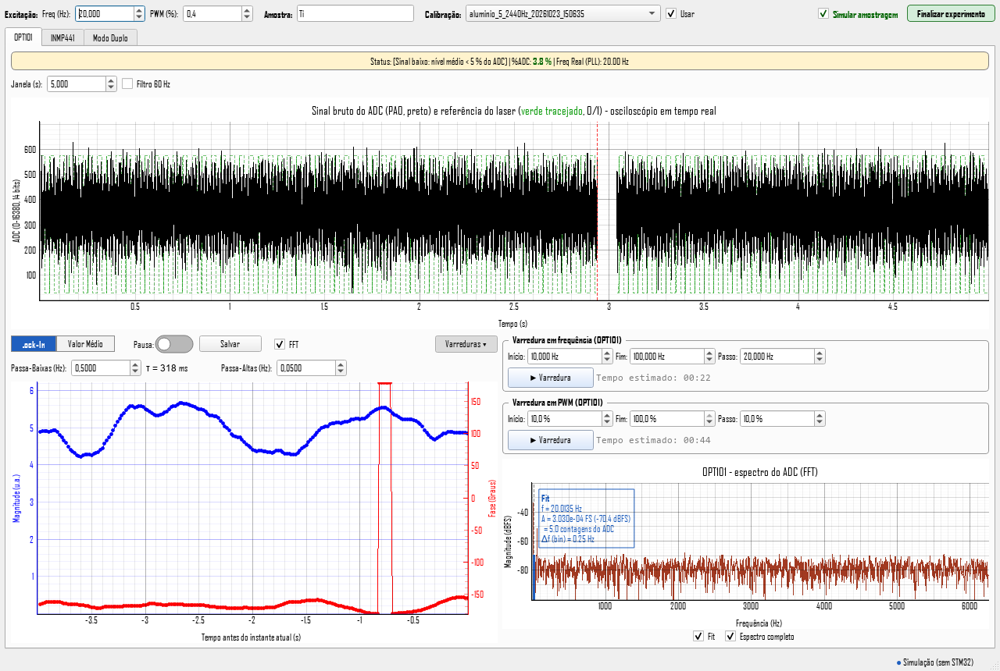

# 4. PC interface – SOI Controller

File: [`interface/soi_controller.py`](../interface/soi_controller.py). Built with PyQt/PySide + pyqtgraph. The lock-in is computed in Python (numpy/scipy), in the same file.

**Language.** The interface is bilingual (Portuguese and English) and picks the language from the Windows display language: Portuguese if Windows is in Portuguese, English otherwise. The environment variable `SOI_LANG=pt` or `SOI_LANG=en` forces one of them. The labels in this document are the English ones. File names, CSV column names and CSV header keys stay the same in both languages, so files from either language open in the other.

## Installation and running

```powershell
pip install -r requirements.txt
python interface/soi_controller.py
```

**Windows executable.** Each [Release](https://github.com/mbelancon/SOI/releases) includes a ready-made executable, with no need to install Python:

- `SOI_Controller_vX.Y.Z.exe`: single file. Just download and run it. On each start it unpacks itself into a temporary folder, so it takes a few seconds to appear.
- `SOI_Controller_vX.Y.Z_pasta.zip`: the same interface as a folder. Unzip it and run `SOI_Controller.exe`. It starts faster.

In both cases the `Medidas/` folder is created next to the `.exe`. Because the executable is not signed, Windows SmartScreen may warn the first time: click "More info" and "Run anyway".

**Required CPU.** The executable and current versions of numpy (2.4 or newer) and Qt (6.10 or newer) require an x86-64 CPU with the SSSE3, SSE4.1, SSE4.2 and POPCNT instructions, the level called x86-64-v2. Any Intel since 2009 (1st-generation Core i3/i5/i7 onwards) or AMD since 2011 (FX/Bulldozer, Ryzen) qualifies. On older CPUs, such as AMD Phenom II/Athlon II and Intel Core 2, the program does not start and shows:

```
ImportError: DLL load failed while importing _multiarray_umath: A dynamic link library (DLL) initialization routine failed.
```

Installing drivers or Visual C++ does not help, because the instructions are missing from the CPU itself. On such PCs it is possible to run with older libraries (for example numpy 2.3 and PyQt5 5.15), but in a test with a Phenom II the computer could not keep up with the INMP441 data rate, and the signal was cut. Use a newer PC.

The executable is built by GitHub Actions ([`.github/workflows/executavel-windows.yml`](../.github/workflows/executavel-windows.yml)) whenever a Release is published, and it can also be built manually from the Actions tab. To build it locally on Windows, in a clean venv:

```powershell
python -m venv .venv
.venv\Scripts\pip install -r packaging/requirements-build.txt
.venv\Scripts\pyinstaller packaging/soi_controller.spec             # single file in dist/
.venv\Scripts\pyinstaller packaging/soi_controller.spec -- --onedir # folder in dist/SOI_Controller/
```

The spec ([`packaging/soi_controller.spec`](../packaging/soi_controller.spec)) leaves out unused Qt modules, translations and software OpenGL. It does not use [UPX](https://upx.github.io/): with it the executable is about 14 MB smaller, but Windows 11 Smart App Control blocks the compressed DLLs and the interface does not start (`-- --upx` enables it, for testing).

## Connecting to the STM32

- The port is **detected automatically**. The order is: the environment variable `TL_ARDUINO_PORT` (e.g. `COM7`), if set; then a USB device with VID `0x0483` (STM32); then other known Arduino boards; finally, the only USB port present.
- If the connection drops, the interface **tries to reconnect every 3 s** and resends the current frequency and PWM.
- Serial reading runs in a separate thread (or process): no byte is lost if the interface lags.
- **Modulation check:** the OPT101 PLL locks onto the real laser edges. If it stays unlocked for more than max(5 s, 5 periods), the STM32 is modulating at another frequency: the `F` command was lost, or the board reset to the 5 Hz default. In that case the interface resends the frequency by itself and reports it in the status bar. This mainly protects the INMP441 lock-in, which has no PLL and relies on the STM32 frequency matching the field. While the PLL is unlocked, the OPT101 tab status shows **"PLL unlocked"**.
- **No sleep during measurements (Windows):** while a sweep (OPT101, INMP441 or Dual Mode) or the Resolution test is running, the interface keeps Windows from sleeping or hibernating due to inactivity, and releases it at the end. The screen may still turn off. Closing the laptop lid, or sleeping from the menu or the power button, still interrupts the measurement.
- **Without an STM32**, the option **"Simulate sampling"** appears, which generates simulated OPT101 and INMP441 signals to try the interface.
- Preferences (fields, options, window size, active tab) are saved on exit in the Windows registry (`HKCU\Software\LCTM\SOI Controller`). They are not saved while a sweep is running.

## Excitation bar (common to all tabs)

| Control | Range | Function |
|---|---|---|
| Freq (Hz) | 0 – 5000 | Laser modulation frequency (0 = continuous). Also updates the automatic filter cut-offs. |
| PWM (%) | 0 – 100 | Laser power |
| **Sample** | text | Prefix of every file saved in `Medidas/`. Characters not allowed in file names become `_`. Empty = no prefix. Saved between sessions. |
| Calibration + Use | list | Microphone calibration applied to the Dual Mode frequency sweep. Lists the calibrations in the `Medidas/` folder from newest to oldest (by the date in the name), without the `CAL_` and `microfone_` parts; the full name, the reference and the cell appear in the tooltip. Each item starts with the cell it was made in (`[OPC]` or `[Câmara]`) and with ⚠ if it has not been verified. The list is reread when opened. On start, the newest is selected with **Use** ticked. |
| **Cell** | OPC / Chamber | Cell configuration for the measurement: **OPC** (the sample closes the opening; light from outside, microphone on the other side) or **Chamber** (sample inside, lit through a glass window). A calibration is only valid in the configuration it was made in; if it is from the other one, a red warning appears. Written to the Dual Mode CSV header (`# Celula = …`). Choosing a calibration reference sets the cell automatically. |
| Finish experiment | button | Zips into `Medidas/<sample>_<date>.zip` all files saved during the session (since the interface opened or since the last click) and the calibration in use (CSV and PNG). The originals stay in the folder. During a sweep, it asks you to finish or cancel it first. |

## OPT101 tab

**Status bar:** signal state (*Signal OK*, *Low signal* with mean level < 5 % of the ADC, or *ADC SATURATION*), the peak **%ADC** (green < 50 %, orange up to 70 %, red above), the **real frequency measured by the PLL** and the rate in use (e.g. *12.5 kS/s (OSR 16)*). If USB loses optical samples, *USB losses: N samples* appears in red: the interface fills the gap by repeating the last sample, so that time and the PLL stay correct.

**Oscilloscope:** raw ADC signal (0–16,380) and the laser reference (dashed green), in real time.
- *Window (s)*: 0.005 to 30 s. Above 50 Hz the window is limited to 50 cycles ("Reduced view").
- *60 Hz filter*: notches at 60 Hz and harmonics up to 1.5 kHz (2 Hz wide). Notches less than 5 Hz from the modulation are omitted.
- *Oversampling*: see below. *Resolution test*: see below.
- The oscilloscope keeps at most 120 thousand points. With a long window and a high rate (e.g. 30 s at 200 kS/s), each drawn point is the average of several, so the screen does not freeze. The lock-in, the FFT and the Average mode always use every sample.

### Oversampling

The STM32 (firmware 2.0.0) sends every ADC sample, 12 bits at 200 kS/s, and the interface averages **OSR** consecutive samples before the lock-in, the oscilloscope, the FFT and the Average mode. OSR is chosen at the top of the tab and saved in the preferences:

| OSR | Rate | Averaging window | Typical use |
|---|---|---|---|
| 1 | 200 kS/s | 5 µs | Fast edges in the oscilloscope and in Average mode |
| 2 / 4 / 8 | 100 / 50 / 25 kS/s | 10 / 20 / 40 µs | High modulation (kHz) |
| **16** (default) | **12.5 kS/s** | **80 µs** | Same as version 1.0.0 |
| 32 / 64 | 6.25 / 3.125 kS/s | 160 / 320 µs | Low modulation, less load on the PC |

- The displayed scale is always 0–16,380 (average × 4), as in 1.0.0, whatever the OSR.
- White noise falls as √OSR (+½ bit per doubling), but only with enough noise (dither) and while the noise stays white. The *Resolution test* shows how far this holds for your signal.
- For the lock-in, the choice barely changes the sensitivity: the final noise depends on the τ bandwidth, not on OSR. OSR changes the rate, the usable bandwidth (FS/2) and the reference delay.
- The lock-in magnitude is corrected for the averaging attenuation (see *Averaging correction* at the end of this page) and the phase for the reference delay of each OSR.
- Changing OSR restarts the lock-in, oscilloscope, FFT and Average mode. It is blocked during a sweep.

### Resolution test

Checks whether oversampling is really delivering resolution. Keep the signal **steady** (laser off, PWM 0 %, or constant light), click **Resolution test** and then **Measure**. The interface records raw samples (0.5 to 20 s, default 4 s) and shows:

1. **Noise × N** on a log-log scale: the noise of averages of N samples, in LSB of the 12-bit ADC, computed with the Allan deviation (insensitive to slow linear drift), together with the ideal 1/√N line. While the points follow the line, averaging is gaining resolution. When the curve flattens or rises, 1/f noise, interference or drift dominate, and a higher OSR no longer helps. The red circle marks the OSR in use. Values of N above 64 show the trend for longer averages, such as the lock-in's.
2. **Table:** noise, gain in bits (measured and ideal) and **effective bits** = 12 − log₂(σ·√12), the resolution of an ideal converter with the same noise.
3. **Histogram of raw codes:** if the samples spread over ~1 LSB or more, there is the dither averaging needs. If almost all fall on one or two codes (σ < 0.3 LSB), the average converges to the wrong code and **there is no new resolution**, even if the noise of the averages seems to fall.
4. **Conclusion:** up to which N the gain follows the ideal (at most 0.25 bit below), and a warning if the laser was modulating during the measurement.

*Save CSV and PNG* writes `Resolucao_<date>.csv` (N, kS/s, Allan σ, ordinary σ, ideal, gains and effective bits) and the window image to `Medidas/`.

**Lower plot, two modes:**

1. **Lock-In:** magnitude (blue) and phase (red) versus time. 50 points/s; the plot shows the last 200 (4 s).
   - *τ* (time constant of each low-pass pole): the arrows step through the 1–3–10 sequence (1 ms, 3 ms, 10 ms, 30 ms, 100 ms, 300 ms, 1 s, 3 s, 10 s, 30 s and 100 s), and a typed value in between (e.g. 0.5 s or 200 ms) is also accepted. When the frequency changes, τ goes back to automatic: ~3 modulation periods, rounded to 0.3 s (above ~5.8 Hz), 1 s (~1.8 to 5.8 Hz) or 3 s (below that). Next to it, computed from τ: the −3 dB cut-off of the 2-pole filter (0.644/(2πτ)), the equivalent noise bandwidth ENBW = 1/(8τ) and the 9τ wait used by sweeps.
   - *High-pass* (Hz): automatic when the frequency changes (2 % of f, limited to 0.01–0.05 Hz) and editable by hand.
2. **Average:** mean ADC waveform over N pulses (1–1000), synchronized on the laser rising edge.
   - ◀ / ▶ adjust the pre-trigger in 10 ms steps.
   - **Curve analysis** (with the plot paused): fit of **1 or 2 exponentials** `y = y∞ + A1·e^(−t/τ1) [+ A2·e^(−t/τ2)]` to the *On* or *Off* segment. The interval is chosen with two draggable green lines. **Fit** draws the model with the typed parameters; **Optimize** runs least squares starting from them and shows R².

*Pause* freezes the plot. **Save** writes CSV + PNG of the lower plot to `Medidas/`.

**FFT** (checkbox next to *Save*): spectrum of the raw ADC signal, in a column on the right, in dBFS.
- Default: zoom around the reference, with an FFT of 4 s of history (resolution ≈ 0.25 Hz).
- *Full spectrum*: 0 to 6.25 kHz, 4096-point FFT (≈ 3.1 Hz).
- *Fit*: fits the peak amplitude at the real modulation frequency with the exact shape of a sine in the Hann window and shows A (in FS, dBFS and ADC counts), the peak/floor SNR and the resolution. If the peak is below the low-signal threshold, the plot warns instead of showing the fit.
- *Click and zoom* (in both FFTs, OPT101 and INMP441): a click shows the frequency and magnitude of the nearest point; the wheel zooms, dragging pans, double-click returns to auto scale and right-click clears the marker.



**Sweeps (*Sweeps ▸* button, Lock-In mode only):**
- *Frequency sweep*: start, end and step (0.1–5000 Hz).
- *PWM sweep*: start, end and step (0–100 %), at the current frequency.
- At each point the sweep **waits max(1 s, 9τ) + 0.3 s** for the filter to settle and then **measures for max(1 s, 4τ)**. It shows the estimated time, the remaining time and a progress bar. The same button cancels.
- When it finishes or is cancelled, a frequency sweep (OPT101, INMP441 or Dual Mode) returns to the previous frequency, resending `F` to the STM32, and to the previous filter settings, including hand-tuned ones.
- At the end a window opens with magnitude ± standard deviation and phase versus the swept variable. The axes can be switched to log scale, with a **power-law fit (A·xⁿ)** or a **linear** fit.

## INMP441 tab

Microphone lock-in, with filters **independent** of the OPT101 ones. The reference is numerical: the phase comes from the I2S sample sequence number and the modulation marker, without a PLL.

**Status:** rate of received samples and the **"LOW SIGNAL"** warning when the SNR falls below the threshold.

**Display:**
- **Sweeps ▸** (first on the row): shows the INMP441 frequency and PWM sweeps, which work like the OPT101 ones.
- Plots that can be switched on: **Lock-In**, **Noise/SNR** and **FFT**.
- **R/θ ↔ X/Y**: magnitude and phase, or in-phase and quadrature components.
- **Auto-phase**: zeroes the mean phase of the last 1 s (the signal goes entirely into X). *Offset (°)*: manual correction.

**Lock-in:** τ, High-pass, 60 Hz filter and *Window (s)* (1–60 s displayed). 20 points/s (blocks of 2400 samples at 48 kHz).

**Noise/SNR:** mean and standard deviation of the lock-in output over a moving window (the same window as the plot, up to 30 s). SNR is shown in dB. *SNR alert < (dB)* defaults to 10 dB (signal ≈ 3× noise). Use a window of at least 10τ.

**FFT:**
- Default: zoom around the reference, with an FFT of 4 s of history (resolution ≈ 0.25 Hz).
- *Full spectrum*: 0 to 24 kHz, 4096-point FFT (≈ 11.7 Hz), in dBFS.
- *Fit*: fits the peak near the reference with the exact shape of a sine in the Hann window. Corrects frequency and amplitude even when the tone falls between two bins.

## Dual Mode tab

Measures both lock-ins **in the same step**. The OPT101 R (proportional to the optical intensity) is the power reference for the INMP441 R (photoacoustic signal).

**Top of the tab:**
- **Sweep ▸** opens the **frequency sweep** (a single one, used both to calibrate and to measure), with **Refine resonance**, and, collapsed next to it under **Matched PWM ▸**, the matched PWM sweep.
- **Calibration ▸** opens the microphone calibration panel: reference, expected curve, mounting tips, cell diagram and the **Generate calibration curve** and **Verify with this measurement** buttons. With it open, running the sweep first shows a warning if PWM is not at 100 %, if any 60 Hz filter is on or if **Use** is ticked (with "Fix and run", "Run anyway" or "Cancel").
- **Fit ▸** opens the model panel (see below), including **Range with S ∝ f⁻ⁿ**.
- The three panels start closed and their state is saved between sessions. **Double-click** on a plot resets the axes/zoom.
- **Open sweep…** loads any Dual Mode CSV from the Medidas folder, frequency or matched PWM, including old formats. The sweep appears as if it had just run: you can apply a calibration, fit models, exclude points and generate a calibration curve (untick **Use** first).
- **Save again** with an opened sweep writes `<original name>_editado_<time>.csv`, recording the source file in the header.
- **Limitation:** an opened sweep does not carry the filter settings used at each point, so the optical channel bandwidth does not appear on the "Light (OPT101)" line.

**τ of the frequency sweeps** (calibration and measurements): there is no "Measurement" choice. They always use long integration: during the sweep both low-pass filters take this τ (the values are restored at the end), and at each point the sweep waits 9τ and averages over 1τ. The τ field is the INMP441 τ: it starts with the INMP441 tab value, and changing τ in any of the places (INMP441 tab or sweep panel) changes the others. Changing the excitation frequency sets the INMP441 τ to the automatic value, and the sweeps follow.

**Measurement** for the matched PWM sweep:
- *Time average (current τ)*: uses the current filters. Waits 9τ of the slower lock-in and averages over 4τ.
- *Long integration (sweep τ)*: temporarily applies the chosen τ to both low-pass filters (restored at the end). Waits 9τ and averages over 1τ. Less noise per point, but the sweep takes longer.

**Sweeps:**
1. **Matched PWM**: INMP441 R × OPT101 R plot with a **linear fit**, and OPT101 R × PWM plot. Checks the linearity of the photoacoustic signal with power.
2. **Frequency (normalized by the OPT101)**: **logarithmic** (N points) or **linear** (step) spacing. The plots show **S = R_INMP441 / R_OPT101** and **Δφ = φ_INMP441 − φ_OPT101** (unwrapped). **Plot arrangement** (right-click on a plot → Plot arrangement): *side by side*, *stacked* (shared x axis; the frequency scale is on top of the upper plot and at the bottom of the lower one, with the axis name only once, so the two sit together) or *overlaid*, with S on the left axis and the phase on the right axis. In every arrangement the S axis is blue and the phase axis is red, matching the curves. When overlaid, zoom, pan and click-to-exclude act on the S plot; the phase follows the x axis and scales itself. The choice is saved. The matched PWM sweep is always side by side, because the x axes differ.

**Layout:** the Sweep, Calibration and Fit panels open above the plots, and the plots take the rest of the screen. Text results (calibration, Diagnostics, applied calibration, Light) appear in a **floating box over the plots**: drag it by its title to move it off the data, or collapse it with ▾. The position is saved. Long texts (full verification, likely causes, Diagnostics details) are in the tooltips. The Calibration panel takes only the height its contents need; on narrow screens it scrolls horizontally instead of widening the window.

**Normalize by OPT101** (ticked by default, frequency sweep only): unticked, plots and fits use the INMP441 R and phase alone, without dividing by the OPT101 R or subtracting its phase. Useful to see the raw microphone response or to tell a laser effect from a cell effect. Without normalization, the microphone calibration is off, because it is defined for the normalized signal. The saved CSV still has both raw channels and records in the header whether normalization was on.

**Show each sensor's signals:** opens a second row of plots with each sensor's signal separately: INMP441 and OPT101 amplitude, each divided by its own median over the sweep (the legend shows that median), and each phase, unwrapped. This shows which sensor a variation in the normalized curve comes from (for example, the resonance appears only in the INMP441, and a drop in laser power appears in both). In the PWM sweep, the x axis is PWM.

**Diagnostics** (frequency sweep): separates the photoacoustic signal from background. It fits amplitude and phase together with the model

z(f) = e^(−2πi·f·td) · HP(f) · R(f) · [A·(f/100 Hz)^−n·e^(iα) + B·e^(iβ)]

where the first term in brackets is the photoacoustic part (power law, constant phase) and the second is a flat background (amplitude and phase that do not change with frequency: scattered light reaching the microphone, laser driver noise coherent with the modulation, electrical coupling). HP is the microphone high-pass, td the system delay and R the cell resonance (included only if there is a peak). The fit is done with and without the background, and the background is only accepted if it really improves the fit (BIC criterion). The plot shows, with a legend, the model (black), the photoacoustic component (dashed red) and the flat, non-photoacoustic background (dashed purple). The "microphone channel delay" is the pure delay of the microphone chain relative to the OPT101 chain, almost entirely from the INMP441 digital filter (~0.35 ms at 48 kHz); it is neither the sound flight time nor the thermal delay of the sample (that is in the phase of the photoacoustic component), and the driver/laser delay cancels in Δφ. The text is short: n, fc, delay, f₀ and Q and, if there is background, a red warning of where it dominates, asking you to check the setup and not generate a calibration. Details (background/photoacoustic ratio at several frequencies, phase difference, uncertainties and residual) are in the tooltip and in the CSV. It uses the same points as the fit (respects exclusions, calibration and normalization) and goes into the CSV header on "Save again". It takes a few seconds and does not run during the sweep. It needs at least 12 points covering one decade.

**Refine resonance** (in the frequency sweep panel): fits the cell resonance (damped oscillator + background, above 250 Hz only) on the current sweep or an opened one and measures more points, evenly spaced, within the peak width: f0 ± f0/(2Q) (between 2 % and 25 % of f0). "New points" sets how many (12 by default); points within 0.5 % of an existing one are skipped. It uses the panel's τ. The new points are inserted in frequency order into the same sweep, excluded points stay excluded, and at the end the CSV is written again (new file) with all points and the line `# Refino da ressonância: …` in the header.

**Excluding points from the fit:** click a point on the left (magnitude) plot to remove it from the fit. It turns hollow and grey, and the fit is redone immediately; click again to include it, or use **Include all**. When points overlap, the one nearest the cursor is used. Excluded points are listed below the plot, in the Dual Mode CSV header (the data stay complete) and, in the calibration, with `Valido = 0` and a header line. A new sweep starts with no exclusions.

**Save again:** the Dual Mode CSV and PNG are saved automatically at the end of the sweep. After excluding points or changing the fit or calibration, use **Save again** to write new files with the `_editado` suffix. Their header carries the current fit, exclusions and calibration, plus the name of the original file, which is not changed.

**Fit with models** (**Fit ▸** panel, frequency sweep only). Fits magnitude, phase or both with open-cell models (light from outside, microphone behind the sample). With x = √(f/f₁) and f₁ = α/(πL²):

- **Range with S ∝ f⁻ⁿ (expected n of the sample)**, first in the list: choose the **expected n** (1 for an opaque sample in the chamber, 1.5 for a thin foil in OPC). The fit searches for the widest continuous range of the sweep where S follows f⁻ⁿ (free n within ±0.15 of the expected value, deviation ≤ 1.5 dB rms and constant phase ± 10° rms) and shows it shaded green on both plots. Outside it, the shape comes from the system (leak, resonance) or the sample is not what was expected. With the calibration applied, the range shows where the calibration holds. Range: from … to limits the search.

| Model | S(f) ∝ | Result |
|---|---|---|
| Power law | f⁻ⁿ (constant phase; magnitude only) | n |
| Two power laws (with break) | f⁻ⁿ¹ below fb, f⁻ⁿ² above (continuous; magnitude only) | n₁, n₂, fb (dotted line on the plot) |
| Thermal diffusion (slab, rear detection) | f⁻⁰·⁵ / [σL·sinh(σL)], σL = (1+i)x | f₁ |
| Thermoelastic bending (Perondi–Miranda) | f⁻¹·[(1 − 1/x) + i/x] | f₁ |
| Chamber: opaque sample (RG) | f⁻¹, constant phase (closed cell, sample inside) | residuals (no shape parameter) |
| Chamber: transparent, thermally thick (RG) | f⁻¹·⁵, constant phase | residuals (no shape parameter) |
| Cell resonance | A·e^{i(φ0 − 2πfτ)}·[f₀²/(f₀² − f² + i·f·f₀/Q) + b·e^{iβ}] | f₀, Q, width f₀/Q, peak gain (dB) |

- **Free constants:** each model's amplitude and phase are free. With the calibration applied (**Use**), the corrected data are the sample response (the theoretical curve of the calibration reference has already been removed), so the model describes only the sample. Without calibration, the panel warns that magnitude and phase include the microphone/cell response and the system delay.
- **Thickness:** with **Thickness L** given, the panel computes the thermal diffusivity **α = π·f₁·L²**. The uncertainty shown does not include that of L, which enters twice.
- **Range:** **Range: from … to … Hz** limits the fit to the region where the model holds. Points excluded by clicking are also left out. The dashed green curve is drawn only over the fitted range.
- **Files:** the result goes into the Dual Mode CSV header (use **Save again** after fitting).
- **Ti of 2026-10-23:** bending fitted on the phase gave f₁ ≈ 22–23 Hz (residual ~11°). Pure diffusion does not describe this Ti.
- **Chamber models (RG):** for test samples inside the chamber, such as glass, after calibrating. A semi-transparent sample lies between f⁻¹ and f⁻¹·⁵.
- **Cell resonance:** without a **Range** (start/end), the peak is found automatically (largest excess over a straight line in log-log, window of ±3 widths). With **Mark peak (2 clicks)**, click on the left plot slightly below and slightly above the peak; the clicks fill in the Range. The fit uses magnitude and phase together (or just one) and draws the model on both plots, with a vertical line at f₀. Measure with **Use** unticked: the calibration removes the cell resonance. With fewer than 10 points in the window, a linear sweep around the peak is suggested (step ≤ width/5). In the new cell of 2026-11-10, the 35-point sweep gave f₀ ≈ 1.57 kHz and Q ≈ 6.5 (only 6 points in the window).

**Microphone calibration: one reference generates the calibration and a second, different reference checks it.** It is in the **Calibration ▸** panel at the top of the tab.

*Why two references:* in the chamber, the cell has a Helmholtz resonance and the microphone channel (and any leaks) is not flat, so the system response enters the shape of S(f). A single reference cannot tell "the sample does not follow f⁻ⁿ" from "the system is not flat". The second reference, corrected by the calibration, must follow f⁻ⁿ.

**Reference.** The **Reference** box chooses the standard. Each has a theoretical curve S ∝ f⁻ⁿ with constant phase and is valid in one cell configuration, which is selected automatically in **Cell** (top row). Next to the box are the editable parameters (thickness L and diffusivity α, or n for the custom one), a line with the expected curve and, on the right, a **mounting diagram** with tips: the sample closes the cell (OPC) or sits inside, under the glass window, with the air gap shown (chamber).

| Reference | Cell | Theoretical curve | Parameters | Notes |
|---|---|---|---|---|
| Thin Al foil (OPC mode) | OPC | f⁻¹·⁵, constant phase; valid for f ≪ f₁ = α/(πL²) | L = 12 µm, α = 0.97 cm²/s | f₁ ≈ 214 kHz. Warning if the sweep goes beyond f₁/10. This is the calibration of earlier versions. |
| Thick Al inside the chamber | Chamber | f⁻¹, constant phase (Rosencwaig–Gersho, opaque) | L, α (informative only) | Shows μ = √(α/πf) and the thin/thick transition; f⁻¹ holds in both regimes. Weak signal: Al reflects ~90 %. |
| Thin Al foil inside the chamber | Chamber | f⁻¹, constant phase (opaque, thermally thin on a thick backing) | L, α (informative only) | Foil with the matte side toward the laser, flat and stuck onto paper, plastic or double-sided tape on the chamber floor. The signal depends on contact with the backing (no wrinkles or bubbles). Weak signal. |
| Matte black painted Al (chamber) | Chamber | f⁻¹ above ~100 Hz | L, α (informative only) | The paint is an insulating layer on the Al: below ~10–100 Hz (depending on thickness) part of the heat goes into the Al and the signal drops. Above that it behaves like the black tape (on 2026-11-10 both curves had the same shape between 70 and 700 Hz). |
| Carbon black (chamber) | Chamber | f⁻¹, constant phase | none | **Recommended for generating the calibration.** Classic photoacoustic standard. Candle soot on a piece of glass slide (insulating backing, not metal), in a thick layer (~0.1 mm, matte black and opaque against the light), at the same height as the samples. Fragile: do not touch or blow on it. |
| Matte black tape (chamber) | Chamber | f⁻¹, constant phase | none | Quick to mount, high signal. Good for checking the carbon black calibration ("Verify with this measurement"), or for generating one. Limit the Range to ~1 kHz. |
| Custom (power law) | the one chosen in Cell | f⁻ⁿ, constant phase | n | For another standard with a known exponent. |

Not suitable as references: **glass and PVC** (the exponent depends on absorption at the laser wavelength) and **black-painted Al foil in OPC** (the paint becomes thermally thick above ~0.1 Hz and destroys the f⁻¹·⁵). Glass and PVC are fine as test samples, with the chamber models of the Fit panel. In the chamber, leave 2–3 mm of air or more above the sample (μ of air at 5 Hz ≈ 1.2 mm); the glass window also absorbs a little, which matters more with polished Al.

1. Choose the reference and mount it as in the diagram. Open **Sweep ▸**: it opens with 5 to 2440 Hz, 35 logarithmic points and τ = 2 s (≈ 12 min; this is the INMP441 τ). With the Calibration panel open, running shows the PWM/60 Hz/Use warning.
2. **Generate calibration curve**: nothing is saved without this click, so keep only useful calibrations (clean, repeatable curve). There is no model fit: in theory the reference gives S ∝ f⁻ⁿ (n of the reference: 1.5 for the foil in OPC, 1 for the chamber references), so the calibration stores `M(f) = S(f)·fⁿ`, the relative response of the microphone + cell system, normalized by the **flat range** (widest stretch where M stays within ±1 dB; tolerance under **Advanced ▸**; without a flat range, by the median). The system phase is `Δφ(f) − φ0`, with φ0 the mean phase over the flat range. All points with enough SNR are included, the resonance as well. Before saving, the results box shows how many points enter and where the system is flat (orange f⁻ⁿ line). The button works on an opened sweep too; untick **Use** first, so the curve comes from the uncorrected data.
   - Every new calibration starts as **not verified** (⚠ in the list and in the PNG title, warning whenever it is used) until it passes verification.
   - The header records `# Ressonancia_f0_Hz`, the cell peak above 250 Hz. When the calibration is applied to a sweep whose resonance differs by more than 3 %, a warning appears (sample height different from the reference).
   - Calibrations from earlier versions remain valid (same file format; the `Sensibilidade_Fit` and `No_Ajuste` columns now repeat `Sensibilidade_Rel` and `Faixa_Plana`).
3. The new calibration is already selected in **Calibration:** on the top row. Tick **Use**: frequency sweeps are now corrected by it.
4. **Verify with this measurement.** With **Use** ticked, measure a second reference of a different material, at the same height and mounting (e.g. calibrated with carbon black, check with black tape), choose it in **Reference** and click **Verify with this measurement**. It passes if the corrected reference follows f⁻ⁿ over a continuous range of at least **one decade** (factor 10 in frequency), with |n − expected n| ≤ 0.15, deviation ≤ 1.5 dB rms and constant phase ± 10° rms. The result (range, n, deviations) goes into the calibration file (`# Verificada = sim/nao`). With the same reference as the calibration, the interface only reports repeatability.

**Sensor τ (correction, under "Advanced ▸" in the Calibration panel):** only needed if you change the OPT101 feedback resistor between calibration and measurement. **Measure…** compares the current sweep with another saved one (same light, different resistor) and fills in τ.

**Good practice in the chamber:** samples and references at the same height (same free volume, same f₀); the whole beam on the sample, not grazing the edge or the wall; equalization hole closed the same way in every measurement; clean window (dust and grease absorb and add signal, which matters with reflective samples); repeat the reference to know the repeatability before judging the verification.

## Optical modulation (chopper)

Choose **Optical** in the selector at the start of the excitation bar when the light is modulated outside SOI (a mechanical chopper, a fan) and the source is powered separately (an LED or laser in continuous mode). The OPT101 must see the light **after** the chopper.

- **How it works.** The interface finds the frequency as the largest peak of the OPT101 FFT inside the search range (**Optical modulation search: from … to …**, OPT101 tab; default 20–5000 Hz) and follows it with a second-order PLL running on the OPT101 signal itself (loop bandwidth f/50, 0.5–10 Hz). The phase of that PLL is the reference of **both** lock-ins. Errors of the reference (filter delay, chopper jitter, threshold) cancel in S = R_INMP441/R_OPT101 and Δφ = φ_INMP441 − φ_OPT101, so the PLL only has to keep the frequency inside the lock-in bandwidth.
- **Aligning the microphone.** The ADC (200 kS/s) and the I2S (48 kHz) run from the same crystal, so the ratio of the two rates is exact; the offset between the two streams comes from a "beacon": in optical mode the interface sends `P0` and `F1`, so the STM32 keeps PA8 low and only toggles the reference bit at 1 Hz. The bit-15 edges in the optical stream and the I2S marker mark the same instant; the average of the edges gives the offset with a fraction of a sample (< 1 µs). **Connect nothing to PA8 in this mode.** The firmware does not change (2.0.0).
- **Same phase convention.** The OPT101 phase is reported with the same offsets as with electronic modulation (square wave that switches on at θ = 0, oversampling delay `opt_ref_delay`), so Δφ, the calibrations and the fits are valid in both modes. In optical mode the OPT101 phase itself stays near −90° by construction and says nothing about the optical channel (the τ diagnosis of the optical channel is not shown).
- **Excitation bar.** The selector is the first control (**Electronic** / **Optical**). In optical mode PWM disappears and its place shows the detected frequency (mean of the last second) with ● when locked; the tooltip gives its standard deviation and the rms phase wander. "⚠ mic" means the INMP441 is not aligned yet (it takes a few seconds after connecting). Freq shows the detected frequency and cannot be edited. The working frequency (FFT range, scope window, automatic cut-offs, oversampling gain correction) follows the detected one; the automatic cut-offs are reapplied only when it changes by more than 15 %.
- **OPT101 tab.** The dashed green trace becomes the PLL reference (cos θ ≥ 0), so you can see the lock; Average mode folds the cycles on it. **Search again** forgets the frequency and searches again. With a fan with uneven blades the rotation frequency (f/number of blades) also shows up: narrow the search range around the blade frequency if it locks on the wrong peak.
- **INMP441 tab.** Works as usual, with the reference from the OPT101. The OPT101 and INMP441 sweeps are disabled (the STM32 does not set the frequency).
- **Dual Mode: manual sweep.** **Sweep ▸** shows **Manual frequency sweep (optical modulation)** instead of the automatic one. Click **▶ Start** and change the chopper frequency gradually. With **Record automatically when the frequency settles**, a point is recorded when the PLL is locked, the standard deviation of the frequency in the last second is ≤ **stable** (default 0.5 %) and the frequency is at least **minimum step** (default 5 %) away from the last point; **Record point** measures one now. Each point waits 9τ and averages for 1τ (τ of the box, default 2 s, applied to both lock-ins during the sweep); if the frequency moves more than 2× **stable** (minimum 1 %) or the PLL unlocks, the point is discarded. The recorded frequency is the mean measured during the point. **⏹ Finish** saves `DUPLO_freq_<min>_<max>Hz_optica_<date>.csv`, with `# Modulacao = optica` and a last column `Frequencia_DP_Hz` (standard deviation of the frequency during the point).
- **Calibration.** **▶ Measure A/B** starts a manual sweep; **Finish** stores it in the slot. A and B do not need the same frequencies (B is interpolated on A's grid).
- **Fan noise.** A chopper or fan makes sound exactly at the modulation frequency, coherent with the reference: it adds to the photoacoustic signal. Measure it with the beam blocked after the OPT101 (the OPT101 still sees the light) and compare; **Diagnostics** helps separate a flat background.
- **Simulation.** With **Simulate sampling**, optical mode simulates a fan with slow drift and uneven blades, trapezoidal light and the beacon; **Freq** becomes the knob of the simulated chopper.

## Generated files (`Medidas/`)

All files are UTF-8 CSV, with a comment header (`#`) carrying the parameters. Each CSV has a PNG with the same name. File names and column names are in Portuguese in both interface languages, so data files are always compatible.

| Source | File name | Columns |
|---|---|---|
| Save (Lock-In) | `LockIn_<f>Hz_<date>` | Tempo_s, Magnitude, Fase_Graus |
| Save (Average) | `ValorMedio_<f>Hz_<date>` | Tempo_s, ADC_Medio [, Fit_Exp] |
| Frequency sweep | `OPT101_F_varredura_f<start>_f<end>_<step>_<date>` (or `INMP441_…`) | Frequencia_Hz, Magnitude_Media, Magnitude_DesvioPadrao, Fase_Media_Graus, Fase_DesvioPadrao_Graus, DC_Offset_Medio |
| PWM sweep | `OPT101_P_varredura_p<start>_p<end>_<step>_f<f>Hz_<date>` (or `INMP441_…`) | PWM_Pct, (same columns) |
| Dual Mode, PWM | `DUPLO_casada_pwm<start>_<end>_f<f>Hz_<date>` | PWM_Pct, OPT101_R, OPT101_R_DP, INMP441_R, INMP441_R_DP, INMP441_Fase_Graus, INMP441_Fase_DP, OPT101_Fase_Graus, OPT101_Fase_DP |
| Dual Mode, frequency | `DUPLO_freq_<start>_<end>Hz_pwm<p>_<date>` | Frequencia_Hz, (same columns) |
| Calibration | `CAL_[<sample>_]microfone_<OPC\|Camara>_<start>_<end>Hz_<date>` | Frequencia_Hz, Sensibilidade_Rel, Sensibilidade_Rel_DP, Sensibilidade_Fit, Fase_Sistema_Graus, Fase_DP, Valido, Faixa_Plana, No_Ajuste |

With the **Sample** field filled in, every name starts with `<sample>_` (e.g. `Grafite_OPT101_F_varredura_…`). The exception is the calibration, which starts with `CAL_` and only then carries the sample name: `CAL_<sample>_microfone_…` (without a sample: `CAL_microfone_…`). The `<date>` format is `YYYYMMDD_HHMMSS`. Dual Mode data are always saved **raw**, even with the calibration applied on the plot.

Column glossary: Tempo = time, Fase = phase, Graus = degrees, Media = mean, DesvioPadrao / DP = standard deviation, Frequencia = frequency, Sensibilidade = sensitivity, Valido = valid, Faixa_Plana = flat range.

## Summary specifications

| Item | OPT101 | INMP441 |
|---|---|---|
| Sample rate | 200 kS/s raw; 200/OSR kS/s after oversampling (default 12.5 kS/s) | Exactly 48,000 S/s |
| Resolution | 12 bits per sample; scale 0–16,380 (average × 4) | Signed 24 bits |
| Usable bandwidth | 0 – FS/2 (6.25 kHz with OSR 16) | 0 – 24 kHz |
| Lock-in reference | Software PLL locked to the REF bit edges | Numerical (I2S sequence + start marker) |
| Demodulation | Quadrature, cascaded 2-pole low-pass, DC removal with a 1-pole high-pass | same |
| Lock-in output | ≈50 points/s | 20 points/s (blocks of 2400 samples) |
| Mains filter | Notches at 60 Hz and harmonics up to 1.5 kHz (optional) | same |
| Modulation | 0.1 – 5000 Hz (or continuous) | — |
| Power | 5 kHz PWM, 0 – 100 % in 0.1 % steps | — |
| Screen refresh | 25 frames/s | — |

**Averaging correction (OPT101):** each optical sample is the average of OSR ADC conversions (80 µs with OSR 16). This average attenuates the fundamental by sin(πf·OSR/200 kHz)/(OSR·sin(πf/200 kHz)): with OSR 16, −1 % at 1 kHz, −4 % at 2 kHz and −9 % at 3 kHz; with OSR 1, nothing. The OPT101 lock-in magnitude is already divided by this factor, so the saved R values are corrected. The phase needs no such correction: the reference (REF bit, majority of the OSR samples) is taken from the same window. The fixed reference delay, (OSR−1)/2 samples of 5 µs, enters the digital phase used by the Dual Mode fits.

**PLL details (OPT101):** the PLL locks when the period between edges is within ±(2 samples + 0.1 %) of nominal. The gains are Kp = 0.05 and Ki = Kp²/4, and the frequency is limited to ±5 % of nominal. The PLL unlocks if the mean phase error exceeds 1.1 rad or if no edges arrive for 10 s.
