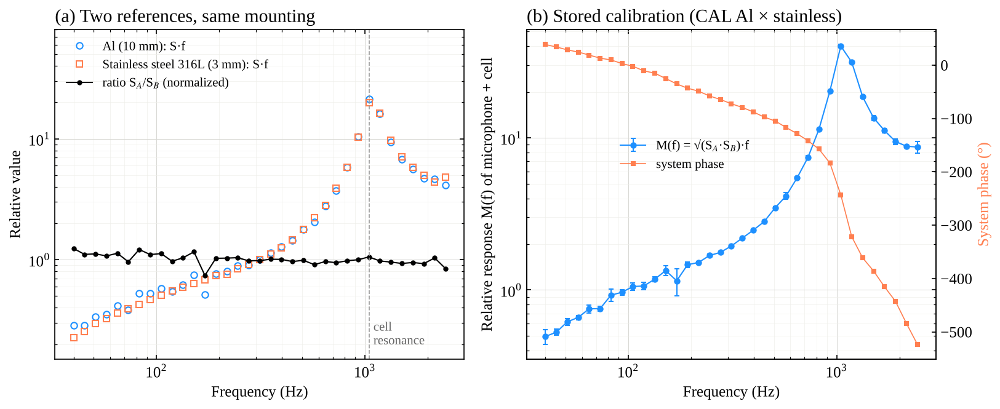

# 7. Microphone calibration (two samples)

The photoacoustic signal measured by SOI is not the sample response alone. The INMP441 channel is not flat, the
chamber has a Helmholtz resonance and any small leak adds a high-pass. The calibration measures this **system
response** so it can be divided out of every frequency sweep. Since version 2.2.0 it is made with **two
reference samples** measured in the same mounting, and the pair checks itself.

## Why two samples

In the chamber, the normalized signal of an opaque, thermally thick sample is

  S(f) = K · H(f) · f⁻ⁿ,  with n = 1,

where K is a complex constant of the sample (absorption, thermal effusivity) and H(f) is the response of microphone
+ cell. With a single reference you cannot tell "the reference does not follow f⁻ⁿ" from "the system is not flat":
both look the same in S(f). This happened on 2026-11-13: a carbon black reference made every sample look like f⁻²,
because raw soot itself rises ~f⁺⁰·⁹ (see [Examples](08_Measurement_Examples.md)). A calibration made from it was
wrong everywhere.

With two different samples A and B in the **same** mounting, H(f) cancels in the ratio:

  S_A / S_B = K_A / K_B = constant (amplitude and phase).

- Where the ratio is flat, both samples are in the expected regime. That range is the **verification**, and it
  needs no theoretical curve.
- The calibration is the geometric mean of the two, with the theoretical slope removed:
  **M(f) = √(S_A · S_B) · fⁿ**, normalized by its flat range (±1 dB).
- The **system phase** is the mean of the two Δφ(f), minus its mean over the flat range.

In OPC mode (the sample closes the cell) the same idea uses two thin foils, with n = 1.5.

## Choosing the pair

The two samples must be in the same regime and still be **different**, otherwise a flat ratio proves nothing. The
interface compares the thermal diffusivity α (chamber) or the thin-foil cut-off f_c = α/(πL²) (OPC) and asks for a
factor of at least **3** between A and B. In the sample B list, green items are good partners for A; red items can be
used, but the calibration is saved with a warning.

| Material | Cell | α (cm²/s) | Notes |
|---|---|---|---|
| Aluminium | Chamber | 0.97 | Block or plate several mm thick, laser face sanded matte (#400). Reflects a lot: smaller signal. |
| Stainless steel 304/316 | Chamber | 0.040 | Plate ≥ 1 mm, matte face. Good signal, stable, easy to find. |
| Titanium | Chamber | 0.093 | Plate ≥ 1.5 mm. α close to stainless: pair it with Al or Ni. |
| Nickel | Chamber | 0.23 | Plate ≥ 2.5 mm. Intermediate α. |
| Brass | Chamber | 0.34 | Block ≥ 3 mm. Cheap. |
| Graphite | Chamber | 1.0 | Plate or electrode ≥ 5 mm. Absorbs a lot: strong signal. |
| Al foil 12 µm / 25 µm | OPC | 0.97 | Kitchen foil (regular or heavy duty), stretched and sealed on the opening. |
| Cu foil 35 µm | OPC | 1.1 | Copper tape without adhesive on the lit area. |

Recommended chamber pair: **aluminium + stainless steel** (α differs ~24×). The interface also checks the thickness
you type: in the chamber the sample must be at least 2μ thick at the lowest frequency, with μ = √(α/πf) the thermal
diffusion length. In OPC the foil cut-off must be at least 10× the highest frequency.

Do **not** use as references: carbon black or soot, black paint or tape on metal (an insulating layer on a conductor
does not follow f⁻¹), glass or plastics (the exponent depends on the optical absorption). These are good *samples*,
not references.

## Procedure

Everything is in the **Calibration ▸** panel of the Dual Mode tab.

1. Choose the **Cell** (Chamber or OPC) on the top bar. The material lists follow it.
2. Choose **Sample A** and type its thickness. Mount it as in the diagram of the Sweep box.
3. Set the sweep. Settings used on 2026-11-17: 40–2440 Hz, 35 logarithmic points, PWM 100 %, adaptive τ with
   τ max 4 s, and **Wait for warm-up** (300 s) on the first sweep. With the Calibration panel open, the interface
   warns before starting if PWM is below 100 %, if a 60 Hz filter is on, or if **Use** is ticked: the calibration
   needs raw data.
4. Click **▶ Measure A**. **Use current** takes the sweep on the screen instead, and **Open…** loads a saved one.
5. Swap to **Sample B** without touching anything else: laser, focus, window, vent hole, sample height. Click
   **▶ Measure B**. The two sweeps do not need the same frequency grid (B is interpolated onto A's).
6. Click **Generate calibration**. The CSV and PNG go to `Medidas/` as
   `CAL_<A>-<B>_microfone_<cell>_<start>_<end>Hz_<date>.csv`, and the new calibration is selected on the top bar.

### Acceptance

The calibration is marked **verified** (`# Verificada = sim`) when the ratio S_A/S_B is constant over a continuous
range of at least **one decade** with:

- |slope| ≤ 0.15 (the ratio must not follow a power of f),
- amplitude deviation ≤ 1.5 dB rms,
- phase deviation ≤ 10° rms.

The interface also compares the cell resonance f₀ found in A and in B. They must agree within ±3 %, or the two
mountings were not the same. A calibration that fails is saved anyway, marked ⚠ in the list, and warns whenever it is
used. The error bars of the calibration come from how much each point deviates from the constant ratio.

## Using a calibration

Pick it in **Calibration** on the top bar and tick **Use**. Frequency sweeps of the Dual Mode are then shown as
S/M(f) and Δφ − system phase, and the fits work on the corrected data.

- **Saved data stay raw.** The CSV always has both raw channels. The header names the calibration that was applied
  to the plot and fit, or says `Calibração … = não aplicada` with the reason. **Open sweep…** with **Use** ticked
  applies a calibration to an old measurement afterwards.
- **Outside the calibrated range** the points are drawn hollow, corrected with the value at the edge, and left out of
  the fits. **Uncalibrated region in red** (off by default) also shades that range. **Show calibration error bars**
  (off by default) draws the calibration uncertainty in green behind the measurement error bars.
- **"Resonance shifted: check the cell assembly"**: a red label appears when the resonance of the sweep differs from
  the calibration's by more than 5 % (or 1.5 sweep steps), or appears in only one of them. Near the resonance the
  correction does not hold.

### A calibration is valid only for its mounting

The resonance f₀ depends on the free volume and on the vent hole. On 2026-11-16 the same parts gave f₀ ≈ 1.07,
1.54 or 1.79 kHz after different assemblies. On 2026-11-17, opening the vent hole moved f₀ from 1047 Hz to 1504 Hz. A
chamber calibration is not valid in OPC mode, and vice versa. Calibrate again whenever the cell is reassembled, and
keep the sample height the same as the references'.

## Example: calibration of 2026-11-17

Aluminium (10 mm) and stainless steel 316L (3 mm), chamber, vent hole closed, 40–2440 Hz, 35 points:

- (a) S·f of each sample rises ~80× towards the resonance: that is the system, not the samples. Their ratio stays
  flat from 40 to 2440 Hz (1.8 decades): slope −0.05 ± 0.01, 0.8 dB rms, phase ± 4° rms, |A/B| = 0.76.
- (b) The stored M(f) and system phase. The resonance is at f₀ = 1047 Hz in both samples. The phase falls ~550°
  across the range, mostly from the resonance and the ~0.35 ms delay of the INMP441 digital filter.
- With this calibration the two references give n = 1.02 and 0.98, and the other samples of the day are in
  [Examples](08_Measurement_Examples.md). Files: [`examples/2026-11-17/`](../examples/2026-11-17/).

## Good practice

- Same height for references and samples (same free volume and f₀). The whole beam on the sample, not grazing the
  edge or the wall.
- Always the same face of each reference. The second face of the stainless plate gave 0.57× the first and agreed
  with aluminium only up to ~130 Hz.
- Vent hole closed the same way every time. Clean window: dust and grease absorb light and add signal.
- Below ~40 Hz the room's acoustic noise dominates and the INMP441 is specified only above 60 Hz. Use a strong sample
  there, or start the calibration at 40 Hz.

## Calibration file

`CAL_*.csv`, with the header (`#` lines) recording the method, the two samples and their files, thicknesses, the
verification result, `Ressonancia_f0_Hz` and `Faixa_concordancia_Hz`. Columns:

| Column | Meaning |
|---|---|
| `Frequencia_Hz` | Frequency |
| `Sensibilidade_Rel`, `Sensibilidade_Rel_DP` | M(f), normalized by the flat range, and its 1 SD |
| `Sensibilidade_Fit` | Same as `Sensibilidade_Rel` (kept for older versions) |
| `Fase_Sistema_Graus`, `Fase_DP` | System phase and its 1 SD |
| `Valido` | 1 = enough SNR and not excluded |
| `Faixa_Plana`, `No_Ajuste` | 1 inside the flat range (both columns, for older versions) |
| `Concorda` | 1 inside the range where the A/B ratio is constant |

Single-reference calibrations from versions before 2.2.0 still load. They should be replaced by a two-sample one.
