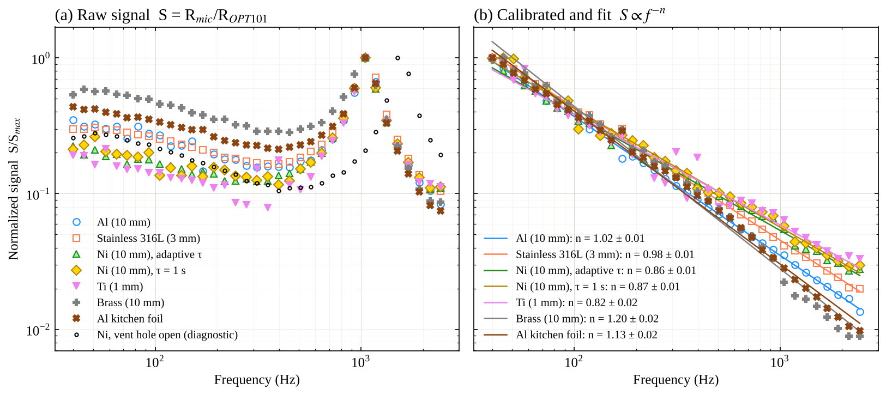
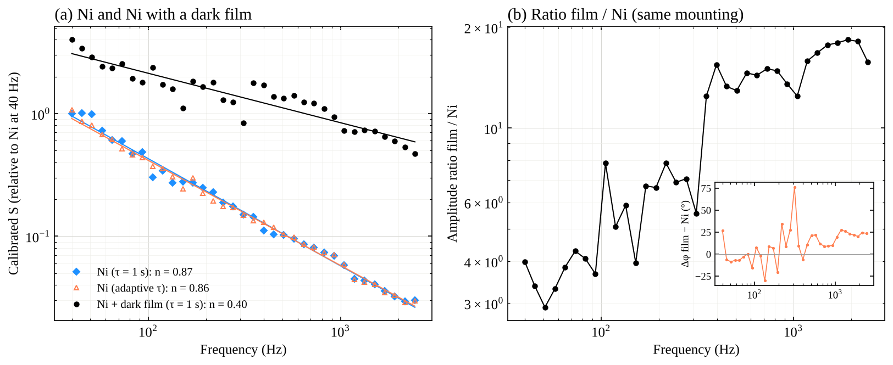
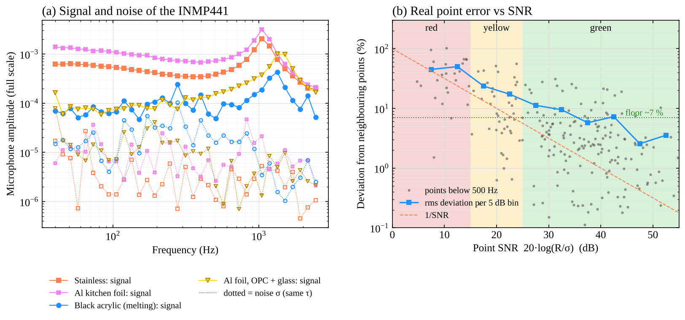

# 8. Measurement examples (2026-11-17)

Real measurements made with SOI in one morning, to show what the system can do and where its limits are. All files
are in [`examples/2026-11-17/`](../examples/2026-11-17/), raw, as written by the interface. The figures on this page
are made from them by [`make_figures.py`](../examples/2026-11-17/make_figures.py).

## Setup

- WeAct Black Pill STM32F401, firmware 2.0.0; interface 2.3.0 (development builds of the day).
- 532 nm diode laser, PWM 100 %, modulation by the STM32 (PA8, through the driver). OPT101 as the light reference,
  INMP441 as the microphone.
- Chamber cell: cylinder 2 cm × 5 mm in diameter, microphone and vent hole halfway up, 1 mm glass window. Vent hole
  closed unless noted.
- Dual Mode frequency sweeps, 40–2440 Hz, 35 logarithmic points. S = R_INMP441/R_OPT101, Δφ = φ_INMP441 − φ_OPT101.
- Calibration: aluminium × stainless steel, made at the start of the morning in the same mounting
  ([Calibration](07_Calibration.md)). Every sample with the vent hole closed showed f₀ ≈ 1047 Hz, the same as the
  calibration, so it applies to all of them.

| File (prefix) | Sample | τ | Duration | Status |
|---|---|---|---|---|
| `CAL_Al-Inox_…` | Calibration from the two sweeps below | — | — | verified |
| `Al_DUPLO_…` | Aluminium block, 10 mm, polished | adaptive, 0.3–2 s | 10 min | reference A |
| `Inox_DUPLO_…` | Stainless steel 316L, 3 mm, polished | adaptive, 0.1–4 s | 16 min | reference B |
| `Ni_DUPLO_…` | Nickel, 10 mm | adaptive, max 4 s | 25 min | valid |
| `Ni_Fast_DUPLO_…` | Nickel, same mounting, untouched | fixed 1 s | 6 min | valid |
| `Ni_Filme_DUPLO_…` | Nickel with an electrodeposited dark film | fixed 1 s | 6 min | valid |
| `Ti_DUPLO_…` | Titanium, 1 mm | fixed 1 s | 6 min | valid |
| `Latao_DUPLO_…` | Brass, 10 mm | adaptive, max 1 s | 5 min | valid |
| `Al_Papel_DUPLO_…` | Kitchen Al foil on the chamber floor | adaptive, max 1 s | 3 min | valid |
| `NegroFumo_DUPLO_…` | Candle soot on a 1 mm glass slide | adaptive, max 1 s | 5 min | valid |
| `Ni_Furo_DUPLO_…` | Nickel, **vent hole open** | adaptive, max 4 s | — | diagnostic (f₀ moved to ~1.5 kHz) |
| `Acrilico_DUPLO_…` | Black acrylic | adaptive, max 1 s | 9 min | diagnostic (sample started to melt) |
| `Al_OPC_Vidro_DUPLO_…` | Al foil closing the cell (OPC) under a glass slide | adaptive, max 1 s | 7 min | weak signal; chamber calibration does not apply |

## Metals: raw and calibrated

**(a) Raw.** Every curve has the same shape: a slow decrease, then the cell resonance at ~1 kHz. The shape is the
system, and the differences between samples are hard to see. With the vent hole open (black dots) the resonance moves
to ~1.5 kHz: this is why a calibration is valid only for its mounting.

**(b) Calibrated** with the Al × stainless calibration and fitted with S ∝ f⁻ⁿ over the whole range:

| Sample | n (40–2440 Hz) | Remark |
|---|---|---|
| Aluminium 10 mm | 1.02 ± 0.01 | calibration reference (n ≈ 1 by construction) |
| Stainless 316L 3 mm | 0.98 ± 0.01 | calibration reference |
| Nickel 10 mm, adaptive τ | 0.86 ± 0.01 | |
| Nickel 10 mm, τ = 1 s | 0.87 ± 0.01 | same mounting: reproducibility Δn = 0.01 |
| Titanium 1 mm | 0.82 ± 0.02 | more scatter |
| Brass 10 mm | 1.20 ± 0.02 | falls faster above 1 kHz |
| Kitchen Al foil | 1.13 ± 0.02 | foil on the chamber floor |

After calibration the resonance is gone and each sample becomes a straight line in log-log, with an exponent known
to ±0.01–0.02. For an ideal opaque, thermally thick sample the Rosencwaig–Gersho model gives n = 1. The departures of
Ni, Ti and brass from 1 are reproducible and point to surface effects (oxide, roughness, finish) or to light
absorbed below the surface. Explaining them needs more samples and is still open. The two Ni sweeps, one 25 min
long with adaptive τ and one 6 min long with τ = 1 s, give the same n: for a sample with good signal, the short
sweep is enough.

## Detecting a surface film

The same nickel substrate with an electrodeposited dark film (material and thickness unknown):

- The film raises the signal 4× at 40 Hz and 15–18× above 400 Hz, and the exponent drops from 0.87 to 0.40.
- Above ~500 Hz the phase is ~20° ahead of the bare nickel (inset).

A constant gain would mean only higher absorption. A gain that grows with frequency, together with the phase lead,
means the heat is generated in, and stays in, a thin layer of low conductivity at the surface: the thermal diffusion
length shrinks with frequency and probes the film more and more. This is the depth profiling that photoacoustics is
known for, done here with a MEMS microphone that costs a few dollars. A quantitative reading (film thickness and diffusivity) needs the
two-layer model and the film thickness.

## Carbon black is not a reference

With the calibration applied, candle soot on glass is flat up to a break at 523 ± 22 Hz and falls as n ≈ 0.82 above
it. It is not f⁻¹. The likely reason is that the porous soot layer is thermally thin at low frequency, so its
thickness sets the break. This is
why carbon black, the "classic" standard, gave a wrong calibration on 2026-11-13 and why SOI now calibrates with two
metals ([Calibration](07_Calibration.md)).

## How good is a point: SNR

**(a)** The INMP441 noise (σ, dotted) is ~10⁻⁵ of full scale for every sample. What changes is the signal: ~10⁻³ FS
for stainless steel and Al foil, ~10⁻⁴ FS for black acrylic and for the OPC + glass mounting. The weak samples end up
at an SNR of 10–20 dB.

**(b)** Real error of each point, measured as its deviation from a smooth curve through its neighbours (points below
500 Hz from all sweeps), against its SNR = 20·log(R/σ):

| Point SNR | rms deviation |
|---|---|
| < 15 dB | ~45 % |
| 15–20 dB | ~24 % |
| 20–25 dB | ~17 % |
| 25–30 dB | ~11 % |
| ≥ 30 dB | ~6–7 % (floor) |

- Above ~30 dB the error stops improving. The ~7 % floor below 500 Hz comes from the room's acoustic noise and the
  warm-up drift, not from the lock-in.
- From 10 to 20 dB the signal is clearly detected (≥ 3σ), but each point is off by 25–45 %. The curve is still
  visible and a fit over many points still works, with a larger uncertainty.
- The colours of **SNR OPT/INMP** on the top bar follow this: green ≥ 25 dB (point error ≲ 10 %), yellow 15–25 dB
  (10–25 %), red < 15 dB (≳ 40 %).
- Most sweeps used τ = 1 s. τ = 2 s adds ~3 dB.

## What this shows about SOI

- **A full photoacoustic spectrum in 3–25 min** (40 Hz – 2.4 kHz, 35 points) with a microcontroller board, a
  photodiode and a MEMS microphone, and the exponent n to ±0.01–0.02 after calibration.
- **Reproducible**: the same Ni mounting measured with different τ settings gives the same n within 0.01.
- **Sensitive to the surface**: a thin film changes amplitude, exponent and phase in a way that can be read as depth
  information.
- **Self-checking**: the two-sample calibration verifies itself, and the interface warns when the cell resonance
  moved (re-assembly, open vent hole) or when a point's SNR is too low.

Limits seen on this day:

- Below ~40 Hz the room's acoustic noise dominates. The INMP441 is specified only above 60 Hz.
- Weak absorbers (acrylic, foil in OPC) give 10–20 dB: usable for trends, not for precise exponents. More laser
  power, a longer τ or a second microphone (planned) would help.
- The cell resonance depends on the assembly, so each assembly needs its own calibration.
