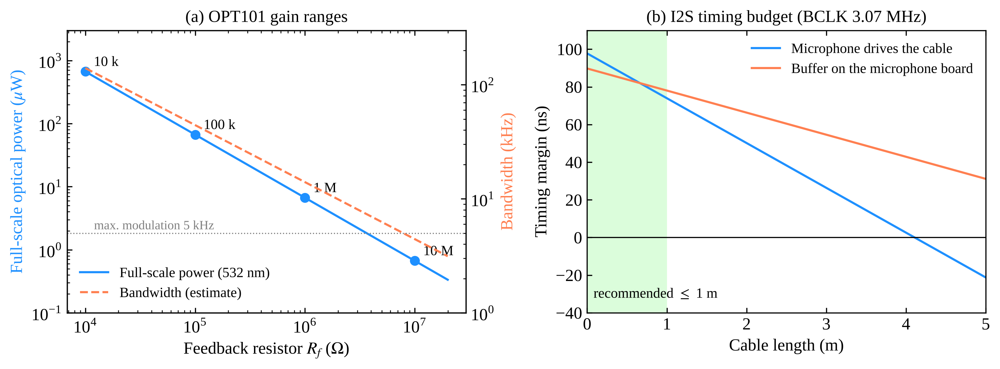

# 9. PCB requirements and options (draft, for review)

Status: **requirements review only**. No schematic yet; KiCad starts after Marcos approves the decisions in
[section 10](#10-decisions-for-marcos). Values marked "≈" are estimates to be checked against datasheets
during the schematic.

## 1. Goal and proposed architecture

Turn SOI into a small instrument that can be built and distributed (device + software), replacing the loose
modules that today add noise, wiring errors and support effort.

Architecture proposed by Marcos:

```
                 metal box ("SOI head")                                 photoacoustic cell
 ┌────────────────────────────────────────────────────┐              ┌───────────────────┐
 │  OPT101 behind a window + diffuser + 532 nm filter │   I2S cable  │ mic board         │
 │  gain ranges (Rf switch)  →  buffer  →  PA0         │◄────────────►│ INMP441 (cell)    │
 │  STM32 (Black Pill or soldered)                     │  ≤ 1 m       │ INMP441 (ref, opt)│
 │  NTC input, I2C header, SWD, BOOT                   │              │ NTC on cell wall  │
 │  USB-C │ SYNC OUT │ TTL IN │ LASER (logic) │ MIC    │              └───────────────────┘
 └───┬────────────────────────────┬───────────────────┘
     │ USB (PC)                   │ logic-level modulation + enable
     ▼                            ▼
    PC                    laser driver next to the laser (own supply)
```

The box holds the STM32 and the OPT101 already fixed to it. A cable leaves the box to the INMP441 board on the
cell. The laser and its driver stay outside the box (section 5).

## 2. What exists today (firmware 2.0.0)

| Pin | Use | Notes |
|---|---|---|
| PA0 | ADC1_IN0, OPT101 | 200 kS/s, TIM3 trigger, DMA; 84-cycle sampling (4 µs of the 5 µs period) |
| PA8 | TIM1_CH1, laser PWM 5 kHz | 0–100 % in 0.1 % steps, gated by the modulation (TIM4, 0.1–5000 Hz) |
| PB0 | laser state (sync) | 1 = laser on |
| PB12 / PB13 / PB15 | I2S2 WS / CK / SD | master RX, Philips, 24-bit in 32-bit slots, 48 kHz → **BCLK = 3.072 MHz** (docs/02 says 2.05 MHz; the firmware clock setup gives 3.072 MHz) |
| PA11 / PA12 | USB FS CDC | |
| PA13 / PA14 | SWD | |
| 25 MHz HSE | | the I2S PLL setup assumes 25 MHz |

Free pins worth reserving on the F401CCU6 (Black Pill): PA1, PA2, PA3, PA4, PA9, PA10, PA15, PB1, PB3, PB4,
PB5, PB6, PB7, PB8, PB9, PB10. Avoid PB2 (BOOT1), PC13 (on-board LED), PB14 (I2S2ext, keep for future
full-duplex).

Proposed allocation (only new firmware work where marked):

| Pin | New use | Firmware |
|---|---|---|
| PB3, PB4, PB10 | OPT101 gain range A0, A1, A2 (8 ranges) | new command, e.g. `G0..G7` |
| PB5 | gain switch enable (all off at reset) | idem |
| PA1 | NTC on the cell wall, ADC1 injected channel (JAUTO after each PA0 sample) | proposal already in memory: PA0 84 → 56 cycles, still < 5 µs |
| PB6 / PB7 | I2C1: ambient sensor (TMP117 or similar), ADS1115 (plan B for the NTC), ID EEPROM | 1 Hz reading |
| PB1 | TTL input (optical chopper / external trigger) → bit 14 of the optical word | already in "Pendências" |
| PB8 | laser ENABLE (hardware AND with PWM and interlock) | on/off command |
| PB9 | interlock state (read only) | reported to the interface |
| PA15 | fan PWM (TIM2_CH1), optional | optional |
| PA9 / PA10 | USART1 debug header | none |

The optical word has bits 12–14 free today; bit 14 stays for the TTL input and the gain range goes in a status
packet (see section 3). Adding the gain command, the status
packet and the TTL bit is a protocol change: per the version rule, firmware and interface go to **MAJOR 3**.

## 3. OPT101 gain control (essential)

### Why
The OPT101 is the power reference of every measurement. Today it uses the internal 1 MΩ resistor and reads
light scattered from the mirror; the useful level depends on the alignment. Other planned techniques need very
different levels: thermal lens / z-scan read the transmitted beam (much more light), luminescence reads nW.

Full scale (OPT101 output 2.0 V at Vs = 3.3 V, responsivity ≈ 0.30 A/W at 532 nm):

| Rf | Full-scale power at 532 nm | Bandwidth (≈, scaled from 14 kHz at 1 MΩ as 1/√Rf) |
|---|---|---|
| 10 kΩ | ≈ 670 µW | > 100 kHz (limited by the amplifier; needs Cf for stability) |
| 100 kΩ | ≈ 67 µW | ≈ 40 kHz |
| 1 MΩ | ≈ 6.7 µW | 14 kHz (datasheet) |
| 10 MΩ | ≈ 0.67 µW | ≈ 4 kHz (below the 5 kHz modulation limit: phase must be calibrated) |



*(a) Full-scale optical power and estimated bandwidth per feedback resistor. (b) I2S timing margin versus cable
length; assumptions: microphone output delay ≤ 60 ns, 5 ns/m propagation, 100 pF/m, SD driver ≈ 200 Ω without
buffer. Script: [`images/pcb_ranges_i2s.py`](images/pcb_ranges_i2s.py).*

### Current setup (prototype)
Today a 500 kΩ potentiometer sits in parallel with the internal 1 MΩ, so Rf = 1 MΩ ∥ R_pot goes from ≈ 0 to
333 kΩ (full scale ≥ ≈ 20 µW at 532 nm). Points to fix on the board:
- Rf is in the reference of every measurement: the wiper resistance and the pot tempco (carbon ~±500 ppm/°C,
  cermet ~±100 ppm/°C, thin-film resistor 25 ppm/°C) go straight into S/OPT101. Touching the pot between a
  calibration and a measurement changes the normalized signal.
- Wires from the pot to the summing node (pin 2) pick up mains (a candidate for the 300 Hz background) and add
  capacitance (gain peaking near the OPT101 bandwidth).
- The setting is not recorded: the board must report the range in the data and in the CSV header.
The useful range today (≈ 100–333 kΩ, to be confirmed with a multimeter) must be inside the new ranges.

### Options

| Option | How | Pros | Cons |
|---|---|---|---|
| **A. Switched Rf (analog switch)** | Internal 1 MΩ disconnected (pin 4 open); external Rf + Cf branches from −In (pin 2) to the output (pin 5), selected by a low-leakage 4:1 analog mux (e.g. TMUX1104 / ADG1204 class, pA leakage) driven by PB3/PB4/PB5 | Changes the real transimpedance: signal ∝ Rf, noise ∝ √Rf, so SNR improves at low light. Silent, small, fast, no wear | Switch leakage enters the summing node (10 pA × 10 MΩ = 0.1 mV, acceptable). Each range has its own Cf, bandwidth and phase |
| **B. Switched Rf (reed relays)** | Same circuit with reed relays | fA leakage: the only good choice for ≥ 100 MΩ (luminescence) | Size, coil current, click, magnetic field near the cell, contact wear |
| **C. PGA after the OPT101** | OPT101 fixed at 1 MΩ; SPI PGA (e.g. MCP6S21, gains 1–32) before the ADC | Fine steps, simple | Amplifies the OPT101 noise and offset too: helps only while the 12-bit ADC step (0.8 mV) dominates. Does not extend the range up (strong light) |
| **D. A + fixed buffer** (recommended) | Option A with 4 decade ranges, then a rail-to-rail op-amp on the 3.3 V analog rail with gain ≈ 1.5 (2.0 V → 3.0 V at the ADC) and an RC (≈ 100 Ω + 2.2 nF) at PA0 | Uses the full ADC scale at the safe Vs = 3.3 V. The op-amp supply is 3.3 V, so PA0 cannot see 5 V: removes the risk of the 5 V OPT101 option | One more op-amp |

Recommendation: **D** with an **8:1 mux** (TMUX1108 / ADG1208 class) and half-decade ranges 10 k / 33 k / 100 k /
330 k / 1 M / 3.3 M / 10 M (thin-film, 0.1 %, 25 ppm/°C), which covers today's pot setting (≤ 333 kΩ) with steps
of ≈ 3×; the eighth position is a spare (or a reed-relay 100 MΩ branch, unpopulated, for luminescence). The
switch goes on the output side of each branch. With 8 ranges the range index (3 bits) goes in a status packet
and in the CSV header, not in the optical word (bit 14 stays for the TTL input); range changes happen only
between measurements anyway. Ranges are selected by the interface (manual, with a "too low / saturated" hint); auto-ranging only
between measurements, never inside a lock-in window. Each range needs a gain and phase calibration (laser
directly on the OPT101), stored on the board (STM32 flash or the ID EEPROM) and written in the CSV header.

The OPT101 supply stays at 3.3 V from a dedicated low-noise analog LDO. The 5 V option (with 1 kΩ + BAT54
clamp) becomes unnecessary with the buffer gain; if kept, the warning about burning the STM32 still applies.

### Optical requirements of the window (from the measurements)
- **Diffuser** in front of the OPT101 and the pick-off taken from a **cover-slip beam splitter**, not from light
  scattered on the mirror: the slow ~1–2.6 % drift seen at night is in the OPT101 reference (mirror/speckle).
- **532 nm band-pass or OG/colour filter slot** and a light-tight baffle: the OPT101 sees room light (300 Hz
  background = 60 Hz harmonic) and the air-conditioner cycle (~36 min) showed up in the reference.
- Window position fixed relative to the box mounting, so the reference does not move when the cable is touched.

## 4. INMP441 cable (I2S)

### Length and timing
BCLK is 3.072 MHz (half period 163 ns). The STM32 samples SD on the rising edge; the microphone changes SD after
the falling edge. Round trip ≈ 10 ns/m plus the microphone delay and the edge slowdown from cable capacitance.
Timing alone allows ≈ 4 m with the microphone driving the cable, more with a buffer (figure, panel b). The
practical limit is signal integrity: ringing on BCLK (a double edge shifts the whole frame), crosstalk BCLK → SD,
and pickup of the laser PWM. Hence:

- **Target ≤ 1 m** (the cell is next to the box anyway). Requirement written for 1 m, tested at 2 m.
- Series termination: 33 Ω at the STM32 on BCLK and WS; 33–47 Ω at the microphone board on SD.
- 100 kΩ pull-down on SD at the box (the INMP441 tri-states SD in the unused slot).
- Lower the I2S GPIO slew rate in firmware (speed LOW/MEDIUM instead of HIGH) to soften edges.
- **Buffer**: not needed up to 1 m. Footprint for a small Schmitt buffer on the microphone board (e.g.
  74LVC2G17: cleans BCLK/WS arriving, or drives SD back) as a fallback. Differential links (RS-485/LVDS) only if a
  > 3 m cable is ever needed.

### Cable and connector

| Option | Pairing | Pros | Cons |
|---|---|---|---|
| **RJ45 + Cat6 S/FTP** (recommended) | BCLK/GND, WS/GND, SD/GND, VDD/NTC | Twisted pairs with a return each, shielded, cheap, any length off the shelf, latching | Someone may plug it into a network port (label it; no PoE risk at the PC side) |
| Mini-DIN 6/8 + shielded multi-core | | Robust, small, cheap | No twisted pairs; crosstalk BCLK → SD |
| M8 circular (4/8 pin) | | Industrial, locking, sealed | Cost; cables less common |

Shield connected to the box (chassis/GND) only; at the cell side via a jumper (0 Ω / 100 nF) so it can be
tested both ways. TVS array (low capacitance, USBLC6-4 class) on the connector lines in the box.

### Microphone board (small PCB on the cell)
- Positions for **two INMP441** on the same I2S bus, L/R by jumper: cell microphone + reference microphone
  (outside the cell or in a blind cell). The firmware then reads both slots (protocol change, MAJOR 3 together
  with the gain).
- Local decoupling (100 nF + 10 µF) and an optional LDO: the cable carries 5 V, the board makes a clean 3.3 V
  (INMP441 PSR −75 dBFS; keeps cable drops and PWM ripple away).
- NTC footprint/pads, so the NTC goes on the cell wall and returns on pair 4 (no extra cable).
- Strain relief: the cable must not pull the cell (vibration coupling at low frequency).

## 5. Laser driver: where it goes

The laser draws hundreds of mA switched at the 5 kHz PWM; its fan produces the 169–172 Hz line seen in the
spectra; and its heat was one reason to move it off the board. The PWM edges were picked up by the thermocouple
through the aluminium.

Recommendation: **driver next to the laser** (or the laser module's own TTL input), with its own supply.
The box sends only logic:

- **LASER connector** (3–4 pins or BNC): MOD (PWM gated by the modulation, buffered to 5 V TTL with a
  74AHCT1G125 or 74LVC1T45), ENABLE, GND. Pull-down so the laser is **off during reset, DFU and power-up**.
- **Hardware AND** of PWM, ENABLE (PB8) and an **interlock** loop (key or lid switch, read on PB9). Needed for
  distribution: a 532 nm module is usually class 3B.
- Optional: footprint for a low-side MOSFET driver on the board, with its own supply input and star ground, for
  small diode modules (< 300 mA). Only if Marcos wants a single-box option.
- Optional fan output (PA15, MOSFET), so the fan can be slowed or moved away from measurement frequencies.

**Information needed from Marcos:** laser model, supply voltage/current, whether it has a TTL or analog
modulation input, and whether the fan is powered by the module.

## 6. Power, grounding and shielding

- USB 5 V only for the box (budget ≈ 60 mA: STM32 ~30 mA, two INMP441 3 mA, OPT101 + op-amps < 5 mA, LEDs).
- Separate **low-noise analog 3.3 V LDO** (LP5907 / TPS7A20 class) for OPT101, buffer and NTC divider. On the
  Black Pill VDDA comes from the board 3V3 (filtered); with a soldered STM32, VDDA/VREF+ can come from this rail
  or a reference.
- One ground plane, analog section (OPT101, buffer, PA0) away from the USB and laser connector; no laser current
  in the box.
- **Metal box** (extruded aluminium with PCB rails, Hammond 1455 type) as shield and chassis, connectors on the
  end panels, OPT101 window on one panel.
- **USB isolation** (ADuM3160/ADuM4160 at 12 Mbit/s + isolated DC/DC): breaks the PC ground loop, a candidate
  source of the 60 Hz harmonics. Costs ~US$ 10 and the DC/DC adds its own ripple. Proposal: footprint with a
  bypass jumper in the first board, decide after measuring.
- Front-panel LEDs: power, **laser on** (driven by the AND output, not by firmware), USB activity.

## 7. Temperature of the cell

From the project memory (18/11): NTC 100 kΩ on the cell wall, isolated from the aluminium with epoxy,
divider with 100 kΩ 0.1 % to the analog 3.3 V, 1 µF at the ADC, read on PA1 as an injected channel right after
each PA0 sample (no lost OPT101 samples). Plan B: ADS1115 on I2C. The PCB provides:

- NTC divider + filter on PA1, signal arriving through the microphone cable (pair 4).
- I2C header (PB6/PB7, 3.3 V) for an ambient sensor (TMP117 or the sensor Marcos already has) and the ADS1115
  if needed.
- The PWM pickup seen with the thermocouple does not apply to an NTC at DC with 1 µF, but keep the NTC isolated
  from the cell metal.

## 8. Black Pill in a socket or STM32 soldered

| | Black Pill in sockets (phase 1) | F401CCU6 soldered | F446RET6 soldered |
|---|---|---|---|
| Firmware | unchanged (+ new commands) | unchanged | port: clock tree and I2S PLL; HAL is the same family |
| Assembly | through-hole headers, easy | needs PCBA (JLCPCB) for QFN48 | PCBA, LQFP64 |
| ADC | 1 ADC; PA0 + injected NTC fits with 56-cycle sampling | same | **3 ADCs simultaneous**: OPT101 DC + an AC-coupled high-gain channel (thermal lens: small change on a large DC) + NTC, without squeezing timing |
| DAC | no | no | **2 DACs**: analog laser current setpoint instead of the 5 kHz PWM (removes the PWM carrier) |
| VDDA / reference | board 3V3 (filtered) | own analog LDO | own analog LDO or reference |
| USB / crystal | on the Black Pill (USB-C must reach the panel) | our USB-C, 25 MHz crystal | idem |
| Repair | replace the module (if PA0 burns) | rework | rework |
| Cost per unit (chip) | ~US$ 4–6 module | ~US$ 2–3 | ~US$ 5–8 |

Recommendation: **phase 1 with the Black Pill in sockets** to validate the analog front end, the gain ranges,
the cable and the box with the current firmware. **Phase 2** (soldered STM32) after phase 1 measurements:
F401 if phase 1 is enough; F446 if the DAC laser control or the simultaneous AC channel are wanted. (An STM32G4
has internal PGAs and op-amps, but a bigger firmware port and no dedicated I2S PLL; not recommended now.)

For both phases: BOOT0 reachable (or a firmware command that jumps to the system bootloader) so the interface can
update the firmware by DFU, and an SWD header inside the box.

## 9. Other connectors on the box

USB-C (PC) · RJ45 (microphone) · LASER (logic) · BNC SYNC OUT (PB0, 50 Ω series, TTL) · BNC TTL IN (PB1,
protected, optional) · interlock jack · internal: SWD, I2C, UART debug. All external lines with series
resistors and ESD protection.

## 10. Decisions for Marcos

1. **Gain control:** option D (8:1 analog mux, half-decade ranges 10 k … 10 M, + buffer), with an unpopulated
   reed-relay 100 MΩ branch? Which pot setting is used today (measure R between pins 2 and 5)?
2. **OPT101 supply:** 3.3 V analog rail only (recommended), dropping the 5 V option?
3. **Cable:** RJ45 + Cat6 S/FTP, target 1 m, buffer footprint only?
4. **Microphone board** with two INMP441 positions + NTC pads (and accept firmware/interface MAJOR 3 for the gain
   command/status packet and two channels)?
5. **Laser driver** outside the box, logic connector + hardware interlock? Laser model/supply/TTL input? On-board
   MOSFET footprint as an option?
6. **USB isolation:** footprint with bypass in phase 1?
7. **Phase 1 with the Black Pill in sockets**, F401 vs F446 decided after phase 1?
8. **Box:** extruded aluminium (Hammond 1455 type) with OPT101 window, diffuser and filter slot?
9. **Temperature:** NTC on PA1 (injected) as main, I2C header for ambient/TMP117/ADS1115?
10. **Licence for distribution:** CERN-OHL-S (or -P) for the hardware, keep the current software licence?
